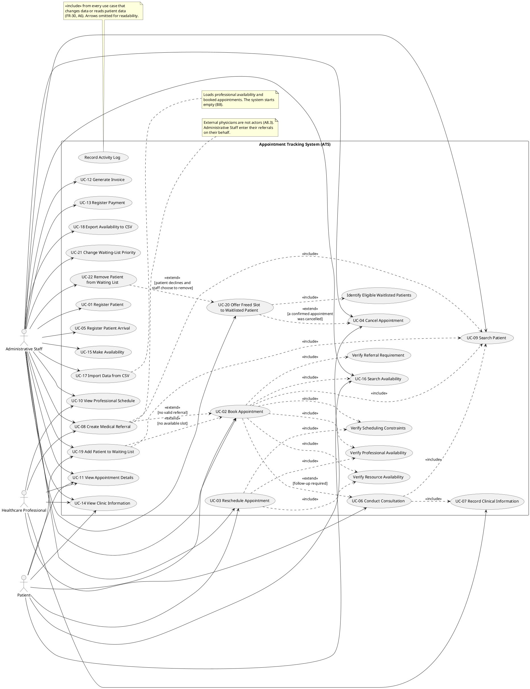

# Iteration II — Updated Use-Case Diagram

**Deliverable:** Updated use-case diagram, including critical and non-critical
use cases.
**Based on:** the Iteration I diagram (`reference-drafts/iteration-1/01-use-case-diagram.md`,
as revised after feedback) plus the new use cases UC-15 to UC-22
(see `00-impact-analysis-and-assumptions.md` §3).

---

## 1. Use-case list

### 1.1 Critical use cases

| ID | Use case | Primary actor(s) | Source | New in Iteration II? |
|---|---|---|---|---|
| UC-01 | Register Patient | Administrative Staff | FR-01–FR-04 | |
| UC-02 | Book Appointment | Administrative Staff, Patient | FR-09–FR-13 | Now includes *Search Availability* and *Verify Resource Availability* |
| UC-03 | Reschedule Appointment | Administrative Staff, Patient | FR-14 | |
| UC-04 | Cancel Appointment | Administrative Staff, Patient | FR-15 | Now extended by UC-20 |
| UC-05 | Register Patient Arrival | Administrative Staff | FR-16 | |
| UC-06 | Conduct Consultation | Healthcare Professional | FR-17, FR-19, FR-20 | |
| UC-07 | Record Clinical Information | Healthcare Professional | FR-18 | |
| UC-08 | Create Medical Referral | Healthcare Professional (Administrative Staff for external referrals) | FR-21–FR-24 | |
| UC-15 | Make Availability | Administrative Staff | Brief: PoC “Making Availability” | ✔ |
| UC-16 | Search Availability | Administrative Staff, Patient | Brief: PoC “Searching for Availability”; FR-10 | ✔ |
| UC-17 | Import Data from CSV | Administrative Staff | Brief: PoC “Import from CSV” | ✔ |
| UC-19 | Add Patient to Waiting List | Administrative Staff, Patient | Brief: waiting lists | ✔ |
| UC-20 | Offer Freed Slot to Waitlisted Patient | Administrative Staff | Brief: waiting lists | ✔ |

### 1.2 Non-critical use cases

| ID | Use case | Primary actor(s) | New in Iteration II? |
|---|---|---|---|
| UC-09 | Search Patient | Administrative Staff | |
| UC-10 | View Professional Schedule | Administrative Staff, Healthcare Professional | |
| UC-11 | View Appointment Details | Authorized user | |
| UC-12 | Generate Invoice | Administrative Staff | |
| UC-13 | Register Payment | Administrative Staff | |
| UC-14 | View Clinic Information | Any user | |
| UC-18 | Export Availability to CSV | Administrative Staff | ✔ |
| UC-21 | Change Waiting-List Priority | Administrative Staff | ✔ |
| UC-22 | Remove Patient from Waiting List | Administrative Staff | ✔ |

**Why UC-19 and UC-20 are critical:** without them the waiting-list
requirement is not met at all, and UC-20 is what turns a cancellation into a
new booking. UC-21 and UC-22 only adjust an existing list, so the clinic can
run without them for a while.

**Why UC-15 to UC-17 are critical:** they are what the PoC must deliver, and
without them the system has no availability to book (it starts empty).

---

## 2. PlantUML source

> **Arrow direction.** In UML, `<<extend>>` points **from the extending use
> case to the base use case** (UC-19 adds behaviour to UC-02), and
> `<<include>>` points from the base to the included one. The Iteration I
> PlantUML drew its two `<<extend>>` arrows the other way round (its own text
> described the right direction). Both are corrected, here and in the
> Iteration I file: `UC08 ..> UC02` and `UC02 ..> UC06`.

---

## 3. Why each new relationship is there

- **UC-02 `<<include>>` UC-16 Search Availability.** Every booking starts by
  finding a free slot, so search is always part of booking. It is also a use
  case of its own because staff and patients search without booking (the
  brief: “may be used directly or indirectly”).
- **UC-02 / UC-03 `<<include>>` Verify Resource Availability.** Some services
  need a room, equipment or an assisting role (B6). The check always runs;
  for services with no requirement it passes at once. Same reasoning as the
  other verifications in Iteration I.
- **UC-19 `<<extend>>` UC-02 [no available slot].** Joining the waiting list
  happens only when booking finds no slot (B1). Booking does not need it, so
  it is an extend, not an include.
- **UC-20 `<<extend>>` UC-04 [a confirmed appointment was cancelled].** Only
  cancelling a *confirmed* appointment frees a slot (B2). Cancelling a request
  frees nothing, so the extension does not run then.
- **UC-20 `<<include>>` Identify Eligible Waitlisted Patients.** Every offer
  starts from the eligible list (B2).
- **UC-22 `<<extend>>` UC-20 [patient declines and staff choose to remove].**
  The brief: “if the patient declines the appointment, the administrative staff
  *may* choose to remove the patient” — optional, so extend. UC-22 is also
  used on its own (e.g. the patient asks to be removed).
- **UC-19 `<<include>>` UC-09 Search Patient.** The patient must be identified
  before an entry can be made, as in UC-02.
- **Accepted offers reuse UC-02's operations.** When a patient accepts, the
  booking is made with `requestAppointment` and `confirmAppointment` (B3).
  No extra arrow is drawn: UC-20's scenario calls the same system operations.

## 4. What is deliberately not in the diagram

- **No “Manage Resources” use case.** The resource list is predefined (B6).
- **No telephone system actor.** The offer is made by phone, but staff place
  the call themselves and only record the outcome in the ATS.
- **No waiting-list import.** The waiting-list sample file is not part of the
  PoC (B8).
