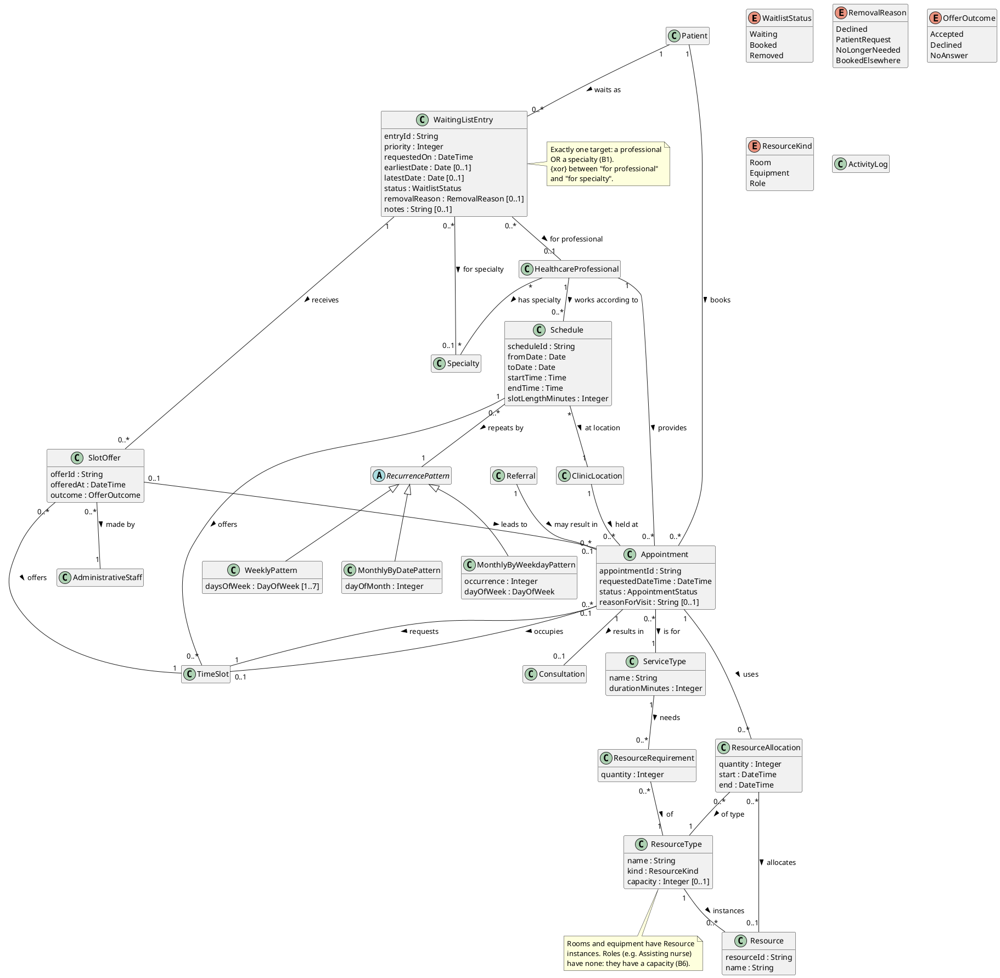

# Iteration II — Updated UML Domain Model

**Deliverable:** Updated UML domain model.
**Nature:** conceptual (analysis-level) model, as in Iteration I: real-world
concepts, attributes and associations; no methods or navigation. The software
classes are in `05-design-class-diagram.md`.
**Starting point:** the Iteration I model (`reference-drafts/iteration-1/02-domain-model.md`,
as revised after feedback). Everything there is kept unless listed in §1.

---

## 1. Changes from Iteration I

| Change | Kind | Why |
|---|---|---|
| `WaitingListEntry` + `WaitlistStatus`, `RemovalReason` | **New** | Waiting lists (B1, B4, B5) |
| `SlotOffer` + `OfferOutcome` | **New** | Freed slots are offered by phone and the outcome is recorded (B3) |
| `ServiceType` | **Promoted** from the string attribute `Appointment.serviceType` | Resource needs depend on the service (B6), and A2 rule 4's durations belong to it |
| `ResourceType` + `ResourceKind`, `Resource`, `ResourceRequirement`, `ResourceAllocation` | **New** | Resource allocation (B6) |
| `RecurrencePattern` (with `WeeklyPattern`, `MonthlyByDatePattern`, `MonthlyByWeekdayPattern`) | **New** | Making availability with a repetition pattern (B7) |
| `Schedule` attributes | **Changed**: `weekday` replaced by `fromDate`, `toDate`, `startTime`, `endTime`, `slotLengthMinutes`, and an association to `RecurrencePattern` | A schedule is now created with a date range and a pattern, and generates `TimeSlot`s (B7) |
| `Appointment.serviceType : String` | **Removed** (replaced by the association to `ServiceType`) | See above |

Unchanged classes are drawn below without their attributes, to keep the
diagram readable; their attributes are exactly as in the Iteration I model.

---

## 2. PlantUML source

---

## 3. Explanation of the new associations and multiplicities

**Waiting lists.**
- `Patient 1 — 0..* WaitingListEntry`: a patient may wait for several targets
  at once (B1), e.g. a dermatologist and, separately, any cardiologist.
- `WaitingListEntry 0..* — 0..1 HealthcareProfessional` and
  `WaitingListEntry 0..* — 0..1 Specialty`: both ends are optional on their
  own, with an **xor** constraint: exactly one is present (B1). This is the
  same technique as the Iteration I `Referral` (requested specialty *or*
  professional). The optional date range is two attributes, not a class.
- `WaitingListEntry 1 — 0..* SlotOffer`: an entry can be offered several freed
  slots over time (a patient may decline one and accept a later one).
- `SlotOffer 0..* — 1 TimeSlot`: one freed slot may be offered to several
  patients in turn (the first declines, the second accepts).
- `SlotOffer 0..1 — 0..1 Appointment` (“leads to”): only an `Accepted` offer
  leads to an appointment, and only if the booking then succeeds (B3).
- `SlotOffer 0..* — 1 AdministrativeStaff`: the offer is a phone call made by
  staff; recording who made it supports accountability (FR-30).
- `priority` is an attribute, not an ordering association: the order of the
  list is derived from `priority` then `requestedOn` (B2), and priority can
  change (B4).

**Services and resources.**
- `Appointment 0..* — 1 ServiceType`: every appointment is for one kind of
  service. This replaces the Iteration I string attribute.
- `ServiceType 1 — 0..* ResourceRequirement 0..* — 1 ResourceType`: a service
  may need several kinds of resource, each in a quantity (e.g. *minor
  procedure* needs 1 procedure room, 1 ECG machine and 1 assisting nurse).
  `ResourceRequirement` exists as a class because the quantity belongs to the
  pair (service, resource type), not to either alone.
- `ResourceType 1 — 0..* Resource`: rooms and equipment are individual things
  that can be booked one by one. Roles have **no** instances (`0..*` allows
  zero) because the brief says they are not tied to specific personnel;
  instead `ResourceType.capacity` says how many can be busy at once.
- `Appointment 1 — 0..* ResourceAllocation`: what the appointment actually
  holds for its time. An allocation always names its `ResourceType`, and names
  a specific `Resource` (`0..1`) only for rooms and equipment. For a role it
  records a quantity against the role's capacity.

**Making availability.**
- `Schedule 0..* — 1 RecurrencePattern`: each schedule is created with one
  pattern (B7). `RecurrencePattern` is abstract with three kinds, because the
  three patterns need different data (days of the week, a day of the month,
  or “n-th weekday”).
- `Schedule 1 — 0..* TimeSlot` (kept from Iteration I) now means: the slots
  the schedule generated over its date range.

---

## 4. Requirement → model traceability (new parts only)

| Requirement | Model elements |
|---|---|
| Waiting list for a professional, specialty or date range | `WaitingListEntry` + its two optional target associations (xor) + `earliestDate`/`latestDate` |
| Identify eligible waitlisted patients on cancellation | Derived from `WaitingListEntry` (status, target, dates) and the freed `TimeSlot` (B2) |
| Offer by phone, by priority; decline → may remove | `SlotOffer.outcome`, `WaitingListEntry.priority`, `status = Removed`, `removalReason` |
| Priority may be changed by staff | `WaitingListEntry.priority` (changes logged in `ActivityLog`) |
| Services needing rooms, equipment or an assisting role | `ServiceType`, `ResourceRequirement`, `ResourceType` (`kind`), `Resource`, `ResourceAllocation` |
| Human resources are roles, not personnel | `ResourceKind.Role` + `ResourceType.capacity`, no `Resource` instances |
| Predefined list of resources | `ResourceType` / `Resource` exist from start-up; no use case creates them (B6) |
| Making availability with date range + repetition | `Schedule` (dates, times, slot length) + `RecurrencePattern` |
| Import / export CSV | No new concept: import creates `HealthcareProfessional`, `TimeSlot`, `Patient`, `Appointment`; export reads `TimeSlot` |
