# Iteration II — Updated System Sequence Diagrams

**Deliverable:** Updated SSDs.
**Conventions (unchanged from Iteration I):** the system is one black-box
lifeline; only actor↔system messages are system operations; internal checks
are notes. Every operation that changes data is logged (A6), which is not
repeated on every diagram.

The Iteration I SSDs for UC-06 and UC-08 are unchanged. UC-02's are updated in
§1; all others are new.

---

## 0. System operations — what changed and what is new

### 0.1 Changes to Iteration I operations

| Iteration I operation | Iteration II operation | Why |
|---|---|---|
| `requestAppointment(patientId, professionalId, locationId, serviceType, slotId, referralId [0..1])` | `requestAppointment(patientId, slotId, channel)` | The slot already identifies its professional and location, so passing them again could only create contradictions. The system looks up the patient's valid referral itself (A4) instead of the actor typing its ID. `channel` (`InPerson` / `Phone`) records how the booking was made (PoC: “a patient that has arrived in a clinic, or over the phone”). `serviceType` returns with resource allocation in Iteration III. |
| `confirmAppointment(appointmentId)` | unchanged signature | New failure reason `ResourceUnavailable` (B6). When the booking comes from an accepted waiting-list offer, success also marks the entry `Booked` (B3). |
| `cancelAppointment(appointmentId)` *(UC-04, not specified in Iteration I)* | `cancelAppointment(appointmentId)` | Returns whether a slot was released and, if so, the eligible waiting-list entries (B2). |

### 0.2 All system operations in these SSDs

| # | Operation | Use case | In PoC? |
|---|---|---|---|
| 1 | `searchPatient(searchCriteria)` | UC-02, UC-19 | ✔ |
| 2 | `registerPatient(firstName, lastName, telephone, ramqNumber [0..1])` | UC-01 (from UC-02) | ✔ |
| 3 | `getProfessionalAvailability(professional [0..1], specialty [0..1], fromDate, toDate)` | UC-02 | ✔ |
| 4 | `requestAppointment(patientId, slotId, channel)` | UC-02, UC-20 | ✔ |
| 5 | `confirmAppointment(appointmentId)` | UC-02, UC-20 | ✔ |
| 6 | `cancelAppointment(appointmentId)` | UC-04 | ✔ (without the waiting list) |
| 7 | `registerProfessional(firstName, lastName, title, specialty)` | UC-15 | ✔ |
| 8 | `makeAvailability(professionalId, fromDate, toDate, pattern, startTime, endTime, slotLengthMinutes)` | UC-15 | ✔ |
| 9 | `searchAvailability(professionalId [0..1], specialty [0..1], fromDate, toDate, onlyFree)` | UC-16 | ✔ |
| 10 | `importAvailability(sourceFile)` | UC-17 | ✔ |
| 11 | `importAppointments(sourceFile)` | UC-17 | ✔ |
| 12 | `exportAvailability(targetFile)` | UC-18 | ✔ |
| 13 | `addToWaitingList(patientId, professionalId [0..1], specialty [0..1], earliestDate [0..1], latestDate [0..1], priority [0..1])` | UC-19 | Iteration III |
| 14 | `getEligibleEntries(slotId)` | UC-20 | Iteration III |
| 15 | `recordOfferOutcome(entryId, slotId, outcome)` | UC-20 | Iteration III |
| 16 | `getWaitingList(professionalId [0..1], specialty [0..1])` | UC-21, UC-22 | Iteration III |
| 17 | `changePriority(entryId, newPriority)` | UC-21 | Iteration III |
| 18 | `removeFromWaitingList(entryId, reason)` | UC-22 | Iteration III |

The operation names 1–12 are the method names of the PoC controllers
(`05-design-class-diagram.md`), so the SSDs, interaction diagrams and code use
one vocabulary.

---

## 1. UC-02 Book Appointment (updated)

### 1.1 Success — patient at the clinic or on the phone

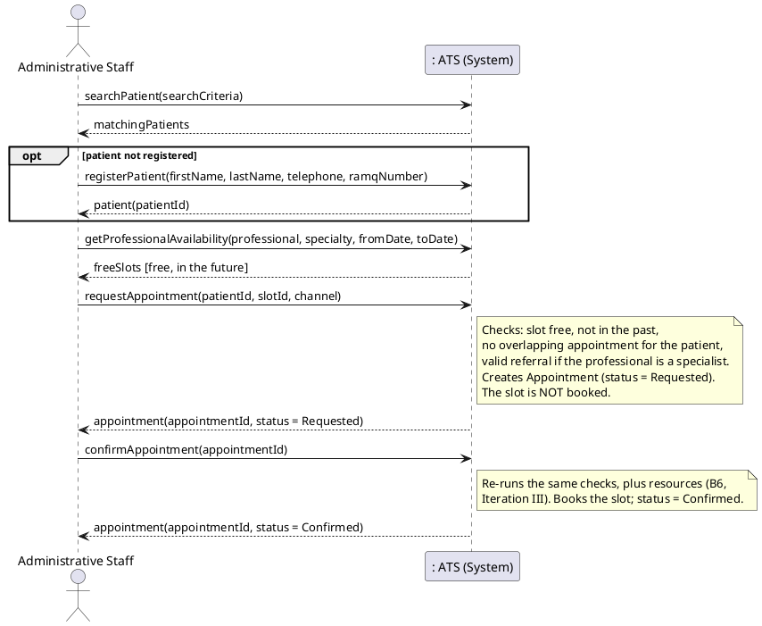

`channel` is `InPerson` when the patient is at the desk and `Phone` when staff
book over the phone; the flow is the same. A patient booking for themselves
follows the same messages.

### 1.2 Failure — no slot available (extends to UC-19)

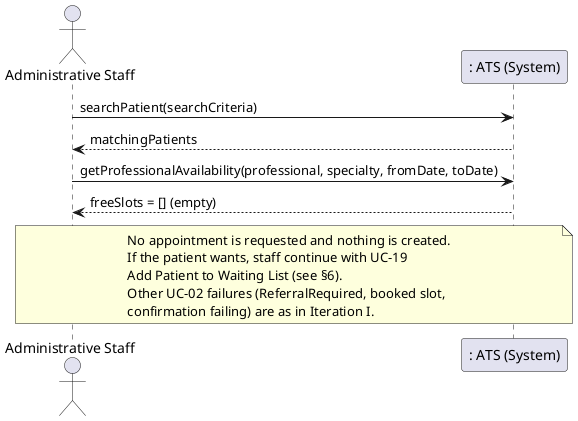

---

## 2. UC-15 Make Availability

### 2.1 Success — “during November, Dr. X is available every Monday, 9 to 12”

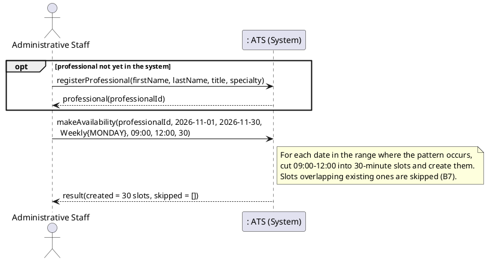

### 2.2 Failure — invalid slot length; partial overlap

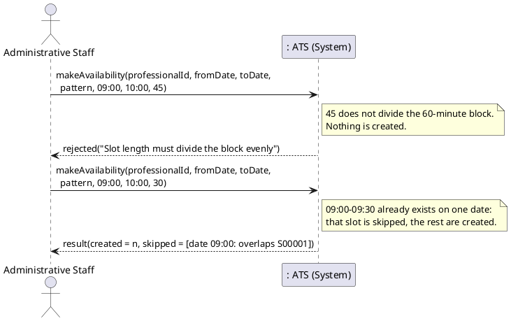

---

## 3. UC-16 Search Availability

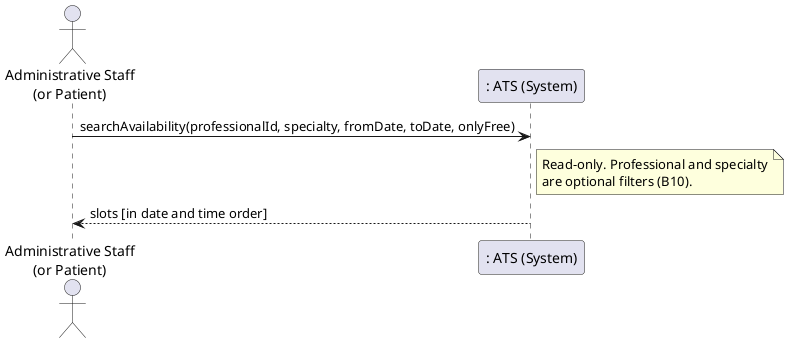

An empty result is a normal answer, not a failure; there is no separate
failure SSD. An unknown `professionalId` is rejected with nothing changed.

---

## 4. UC-17 Import Data from CSV

### 4.1 Success

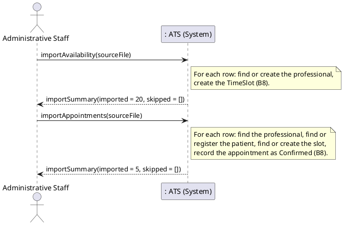

### 4.2 Failure — unreadable file; bad rows

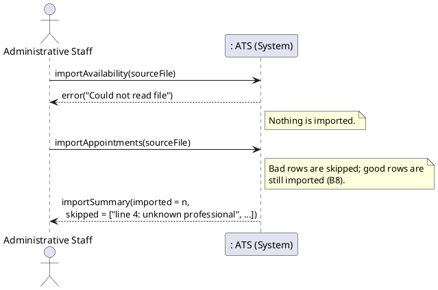

---

## 5. UC-18 Export Availability to CSV

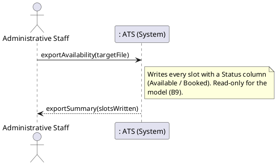

---

## 6. UC-19 Add Patient to Waiting List

### 6.1 Success

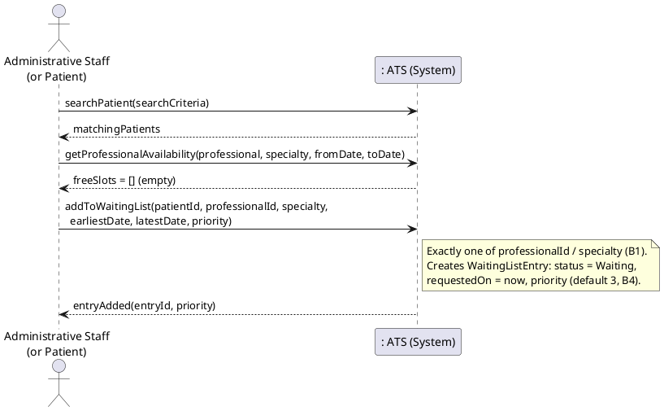

### 6.2 Failure — a slot is available; invalid target

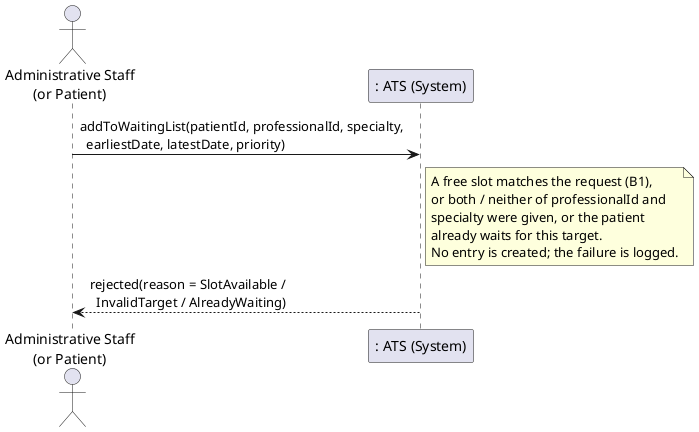

---

## 7. UC-20 Offer Freed Slot to Waitlisted Patient (extends UC-04)

### 7.1 Success — the first eligible patient accepts

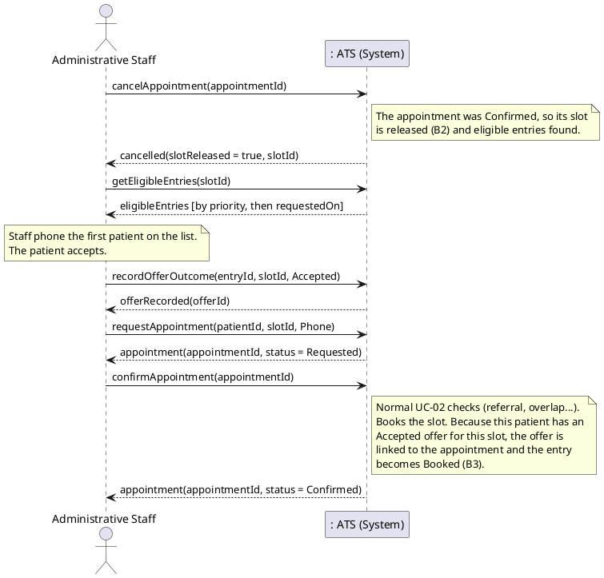

### 7.2 Failure — the patient declines and is removed; the slot was taken meanwhile

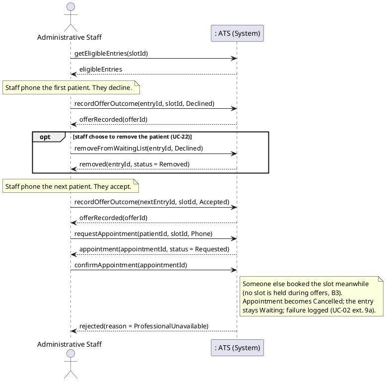

---

## 8. UC-21 Change Waiting-List Priority

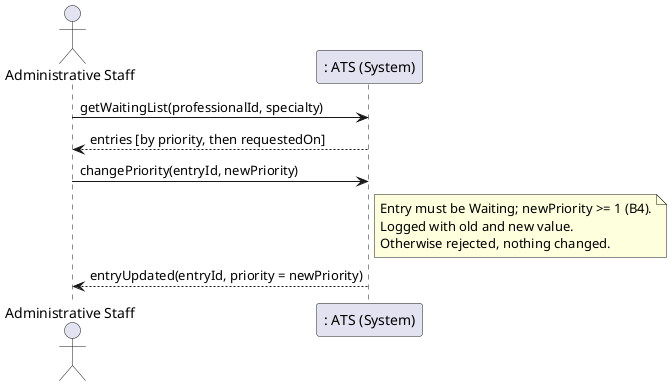

## 9. UC-22 Remove Patient from Waiting List

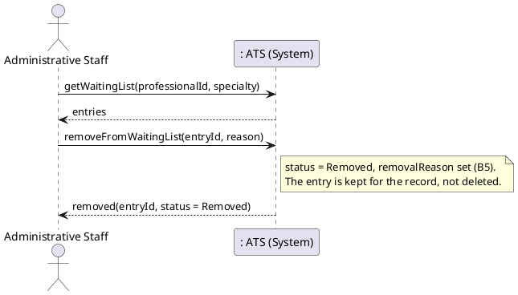
