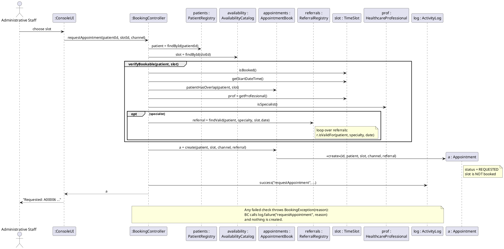
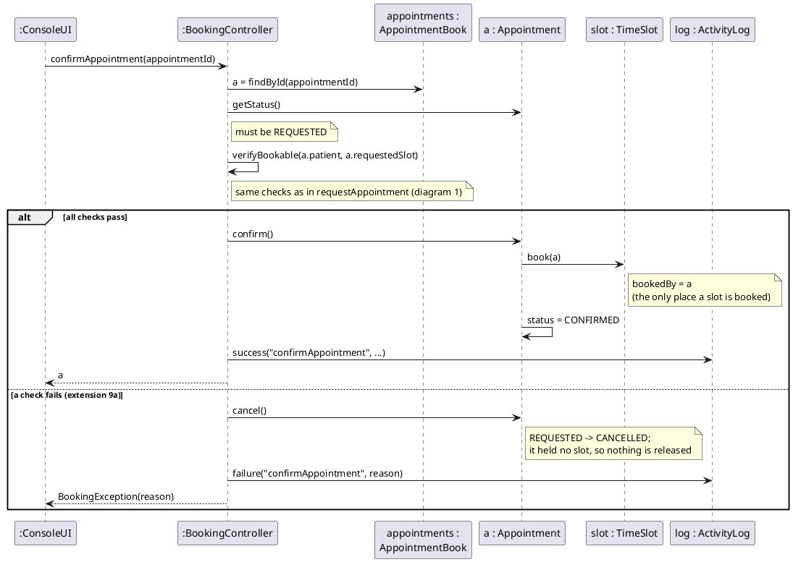
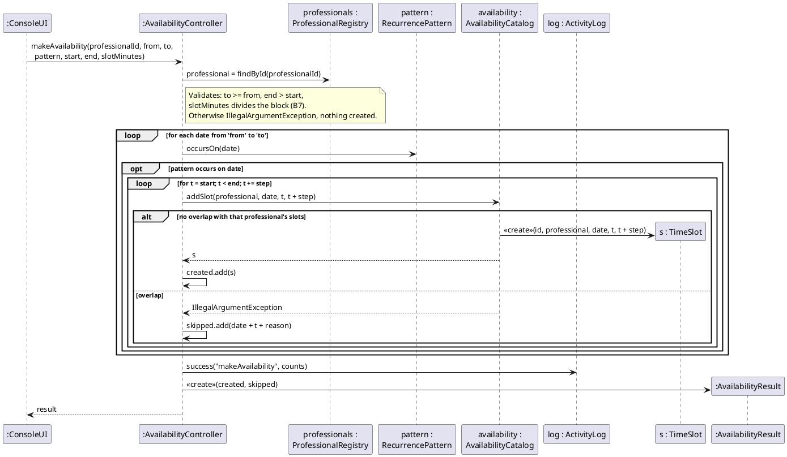
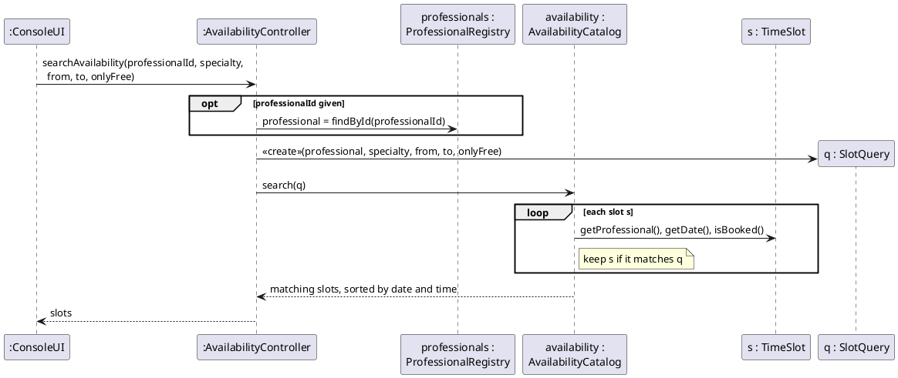
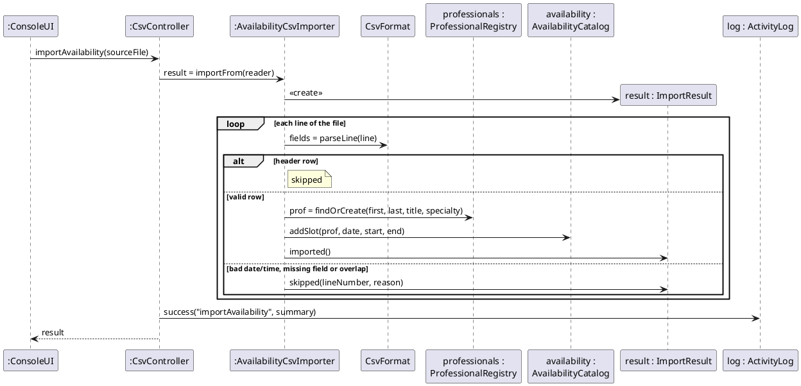

# Iteration II — UML Interaction Diagrams

**Deliverable:** UML interaction diagrams for at least three critical use cases.
**Covered:** UC-02 Book Appointment (`requestAppointment`, `confirmAppointment`),
UC-15 Make Availability (`makeAvailability`), UC-16 Search Availability
(`searchAvailability`), and UC-17 Import Data from CSV (`importAvailability`).
That is four critical use cases and five system operations.

**How these were made.** Each diagram is the design of one system operation
from `03-system-sequence-diagrams.md`. Every message is a real method call in
the PoC (`src/main/java/ats/...`), with the same name and parameters, so the
diagrams, the design class diagram (`05`) and the code agree. Calls that only
read a value (simple getters) are shown only where they matter to a decision.
Activity-log calls are shown once per operation as `log.success(...)` /
`log.failure(...)`.

---

## 0. GRASP decisions used in all diagrams

| Decision | Pattern | Reason |
|---|---|---|
| The console (`ConsoleUI`) never changes domain objects; it calls one controller method per system operation | **Controller** (use-case controller) | Keeps the user interface separate from domain logic. One controller per group of related use cases: `BookingController` (UC-02, UC-04), `AvailabilityController` (UC-15, UC-16), `CsvController` (UC-17, UC-18). A single facade controller would grow too large (low cohesion). |
| `Clinic` creates the registries and the controllers | **Creator** | `Clinic` contains and aggregates them, and records the shared `Clock` and `ActivityLog` they need. |
| `AvailabilityCatalog` creates `TimeSlot`s and refuses overlapping ones | **Creator**, **Information Expert** | It contains all slots, so it is the only object that can know whether a new slot overlaps another. |
| `AppointmentBook` creates `Appointment`s and answers “does this patient already have an overlapping appointment?” | **Creator**, **Information Expert** | It records all appointments. |
| `Appointment.confirm()` books its own slot; `Appointment.cancel()` releases it | **Information Expert** | The appointment knows its status and its requested slot. Keeping the booking in one method enforces “only confirmation books a slot” (Iteration I fix). `TimeSlot.book()` / `release()` are package-private so nothing else can call them. |
| `Referral.isValidFor(patient, specialty, date)` | **Information Expert** | The referral holds the status, dates, patient and specialty that rules A4 1–4 test. |
| `HealthcareProfessional.isSpecialist()` | **Information Expert** | The professional knows their specialty (rule A3). |
| `RecurrencePattern.occursOn(date)` with three implementations | **Polymorphism**, **Protected Variations** | `makeAvailability` does not need to know which kind of pattern it has; a new kind of repetition is a new class, not a change to the controller. |
| CSV reading and writing are in `ats.csv` classes, not in the controllers | **Pure Fabrication**, **High Cohesion** | File formats are not domain concepts. Keeping them apart means a database (Iteration III) can replace them without touching domain classes. |
| Controllers depend on registries, not on each other | **Low Coupling** | Each controller can be tested on its own (see `src/test`). |

---

## 1. UC-02 Book Appointment — `requestAppointment(patientId, slotId, channel)`

**Why this design.** `BookingController` coordinates but decides nothing on its
own: each check is asked of the object that holds the information
(`TimeSlot`, `AppointmentBook`, `HealthcareProfessional`, `ReferralRegistry`).
`AppointmentBook` creates the appointment because it records all appointments
(Creator). The checks live in one private method, `verifyBookable`, because
`confirmAppointment` must run exactly the same checks again.

---

## 2. UC-02 Book Appointment — `confirmAppointment(appointmentId)`

**Why this design.** `Appointment.confirm()` is the Information Expert for its
own state change and books its own slot, so “confirm” and “book the slot”
cannot happen separately. This is the design form of the Iteration I contract
CO-02-4.

---

## 3. UC-15 Make Availability — `makeAvailability(professionalId, from, to, pattern, start, end, slotMinutes)`

**Why this design.** `RecurrencePattern` is an interface with
`WeeklyPattern`, `MonthlyByDatePattern` and `MonthlyByWeekdayPattern`
(**Polymorphism**): the controller only asks `occursOn(date)`.
`AvailabilityCatalog` both creates slots and refuses overlaps (**Creator** +
**Information Expert**), so the overlap rule cannot be bypassed — the same
`addSlot` is used by the CSV import.

---

## 4. UC-16 Search Availability — `searchAvailability(professionalId, specialty, from, to, onlyFree)`

**Why this design.** The search criteria travel as one `SlotQuery` object
rather than five loose parameters, so `AvailabilityCatalog.search` stays
stable if a criterion is added (e.g. resources in Iteration III). The catalog
does the filtering because it holds the slots (**Information Expert**).
While booking, `BookingController.getProfessionalAvailability` uses the same
`search` with `onlyFree = true` and then drops slots in the past.

---

## 5. UC-17 Import Data from CSV — `importAvailability(sourceFile)`

**Why this design.** The CSV format is handled by **Pure Fabrication** classes
(`AvailabilityCsvImporter`, `CsvFormat`) so that no domain class knows about
files. The importer reuses `ProfessionalRegistry.findOrCreate` and
`AvailabilityCatalog.addSlot`, so imported data passes the same overlap rule
as availability made by hand. `importAppointments` follows the same shape with
`AppointmentCsvImporter`.
