# Iteration II — UML Design Class Diagram (partial design model)

**Deliverable:** UML class diagram (partial design model).
**Scope:** the classes of the PoC in `src/main/java/ats`. It is partial on
purpose: waiting lists and resources are in the domain model (`02`) but, as the
brief suggests, their design is left for Iteration III.
**Source of truth:** this diagram was written from the code; names, types,
visibility and navigability match it. Simple getters are omitted (marked
`…getters` where a class has them).

---

## 1. PlantUML source

```plantuml
@startuml
skinparam classAttributeIconSize 0
hide empty members
left to right direction

package ats.cli {
  class ConsoleUI {
    - clinic : Clinic
    + run() : void
    - bookAppointment() : void
    - makeAvailability() : void
    - searchAvailability() : void
    - importAvailability() : void
    - importAppointments() : void
    - exportAvailability() : void
    - cancelAppointment() : void
  }
}

package ats {
  class Clinic {
    - clock : Clock
    + booking() : BookingController
    + availability() : AvailabilityController
    + csv() : CsvController
    + getPatients() : PatientRegistry
    + getProfessionals() : ProfessionalRegistry
    + getAvailability() : AvailabilityCatalog
    + getAppointments() : AppointmentBook
    + getActivityLog() : ActivityLog
  }
  class Main {
    + {static} main(args : String[]) : void
  }
}

package ats.controller {
  class BookingController {
    - clock : Clock
    + searchPatient(criteria : String) : List<Patient>
    + registerPatient(first : String, last : String, telephone : String, ramq : String) : Patient
    + getProfessionalAvailability(p : HealthcareProfessional, specialty : String, from : LocalDate, to : LocalDate) : List<TimeSlot>
    + requestAppointment(patientId : String, slotId : String, channel : BookingChannel) : Appointment
    + confirmAppointment(appointmentId : String) : Appointment
    + cancelAppointment(appointmentId : String) : boolean
    + recordReferral(patientId : String, specialty : String, referrer : String, reason : String) : Referral
    - verifyBookable(p : Patient, s : TimeSlot) : Referral
  }
  class AvailabilityController {
    + registerProfessional(first : String, last : String, title : String, specialty : String) : HealthcareProfessional
    + makeAvailability(professionalId : String, from : LocalDate, to : LocalDate, pattern : RecurrencePattern, start : LocalTime, end : LocalTime, slotMinutes : int) : AvailabilityResult
    + searchAvailability(professionalId : String, specialty : String, from : LocalDate, to : LocalDate, onlyFree : boolean) : List<TimeSlot>
  }
  class CsvController {
    + importAvailability(source : Path) : ImportResult
    + importAppointments(source : Path) : ImportResult
    + exportAvailability(target : Path) : int
  }
  class AvailabilityResult <<record>> {
    + created : List<TimeSlot>
    + skipped : List<String>
  }
  class BookingException {
    - reason : FailureReason
    + getReason() : FailureReason
  }
  enum FailureReason {
    PROFESSIONAL_UNAVAILABLE
    SCHEDULING_CONSTRAINT_VIOLATION
    REFERRAL_REQUIRED
    REFERRAL_NOT_VALID
    PATIENT_NOT_FOUND
    SLOT_NOT_FOUND
    APPOINTMENT_NOT_FOUND
    INVALID_STATUS
    + contractName() : String
  }
}

package ats.registry {
  class PatientRegistry {
    + register(first : String, last : String, telephone : String, ramq : String) : Patient
    + findById(id : String) : Optional<Patient>
    + findByRamq(ramq : String) : Optional<Patient>
    + findByTelephone(telephone : String) : List<Patient>
    + searchByName(partial : String) : List<Patient>
    + search(criteria : String) : List<Patient>
  }
  class ProfessionalRegistry {
    + findOrCreate(first : String, last : String, title : String, specialty : String) : HealthcareProfessional
    + findById(id : String) : Optional<HealthcareProfessional>
    + findByName(first : String, last : String) : Optional<HealthcareProfessional>
    + findByFullName(name : String) : Optional<HealthcareProfessional>
    + search(text : String) : List<HealthcareProfessional>
  }
  class AvailabilityCatalog {
    + addSlot(p : HealthcareProfessional, date : LocalDate, start : LocalTime, end : LocalTime) : TimeSlot
    + findById(slotId : String) : Optional<TimeSlot>
    + findExact(p : HealthcareProfessional, date : LocalDate, start : LocalTime, end : LocalTime) : Optional<TimeSlot>
    + search(q : SlotQuery) : List<TimeSlot>
    + all() : List<TimeSlot>
  }
  class SlotQuery <<record>> {
    + professional : HealthcareProfessional
    + specialty : String
    + from : LocalDate
    + to : LocalDate
    + onlyFree : boolean
  }
  class AppointmentBook {
    + create(p : Patient, s : TimeSlot, c : BookingChannel, r : Referral) : Appointment
    + findById(id : String) : Optional<Appointment>
    + patientHasOverlap(p : Patient, s : TimeSlot) : boolean
    + forPatient(p : Patient) : List<Appointment>
  }
  class ReferralRegistry {
    + record(p : Patient, specialty : String, referrer : String, reason : String, issued : LocalDate) : Referral
    + findValid(p : Patient, specialty : String, onDate : LocalDate) : Optional<Referral>
  }
  class ActivityLog {
    + success(operation : String, detail : String) : void
    + failure(operation : String, reason : String) : void
    + entries() : List<Entry>
  }
}

package ats.domain {
  class Patient {
    - patientId : String
    - firstName : String
    - lastName : String
    - telephone : String
    - ramqNumber : String [0..1]
    + hasRamq() : boolean
    …getters
  }
  class HealthcareProfessional {
    - professionalId : String
    - firstName : String
    - lastName : String
    - title : String
    - specialty : String
    + isSpecialist() : boolean
    + hasName(first : String, last : String) : boolean
    …getters
  }
  class TimeSlot {
    - slotId : String
    - date : LocalDate
    - start : LocalTime
    - end : LocalTime
    + isBooked() : boolean
    ~ book(a : Appointment) : void
    ~ release() : void
    + overlaps(other : TimeSlot) : boolean
    …getters
  }
  class Appointment {
    - appointmentId : String
    - channel : BookingChannel
    - status : AppointmentStatus
    + confirm() : void
    + cancel() : boolean
    …getters
  }
  class Referral {
    - referralId : String
    - requestedSpecialty : String
    - referringProfessionalName : String
    - clinicalReason : String
    - issuedDate : LocalDate
    - expiryDate : LocalDate
    - status : ReferralStatus
    + isValidFor(p : Patient, specialty : String, onDate : LocalDate) : boolean
    …getters
  }
  enum AppointmentStatus {
    REQUESTED
    CONFIRMED
    CHECKED_IN
    IN_CONSULTATION
    COMPLETED
    CANCELLED
    NO_SHOW
    + occupiesSlot() : boolean
  }
  enum BookingChannel {
    IN_PERSON
    PHONE
  }
  enum ReferralStatus {
    DRAFT
    SUBMITTED
    ACCEPTED
    REJECTED
    EXPIRED
    FULFILLED
    CANCELLED
  }
}

package ats.domain.recurrence {
  interface RecurrencePattern {
    + occursOn(date : LocalDate) : boolean
    + describe() : String
  }
  class WeeklyPattern {
    - days : Set<DayOfWeek>
  }
  class MonthlyByDatePattern {
    - dayOfMonth : int
  }
  class MonthlyByWeekdayPattern {
    - occurrence : int
    - dayOfWeek : DayOfWeek
  }
}

package ats.csv {
  class AvailabilityCsvImporter {
    + importFrom(reader : BufferedReader) : ImportResult
  }
  class AppointmentCsvImporter {
    + importFrom(reader : BufferedReader) : ImportResult
  }
  class AvailabilityCsvExporter {
    + exportTo(writer : PrintWriter) : int
  }
  class ImportResult {
    - imported : int
    - skipped : List<String>
    + getImportedCount() : int
    + getSkipped() : List<String>
  }
  class CsvFormat <<utility>> {
    + {static} parseLine(line : String) : List<String>
    + {static} formatLine(fields : List<String>) : String
    + {static} parseTime(text : String) : LocalTime
    + {static} isNone(value : String) : boolean
  }
}

' ---- navigability (who holds a reference to whom) ----
Main ..> ConsoleUI : creates
Main ..> Clinic : creates
ConsoleUI --> "1" Clinic

Clinic *--> "1" BookingController
Clinic *--> "1" AvailabilityController
Clinic *--> "1" CsvController
Clinic *--> "1" PatientRegistry
Clinic *--> "1" ProfessionalRegistry
Clinic *--> "1" AvailabilityCatalog
Clinic *--> "1" AppointmentBook
Clinic *--> "1" ReferralRegistry
Clinic *--> "1" ActivityLog

BookingController --> "1" PatientRegistry
BookingController --> "1" AvailabilityCatalog
BookingController --> "1" AppointmentBook
BookingController --> "1" ReferralRegistry
BookingController --> "1" ActivityLog
BookingController ..> BookingException : throws

AvailabilityController --> "1" ProfessionalRegistry
AvailabilityController --> "1" AvailabilityCatalog
AvailabilityController --> "1" ActivityLog
AvailabilityController ..> RecurrencePattern
AvailabilityController ..> AvailabilityResult : creates

CsvController *--> "1" AvailabilityCsvImporter
CsvController *--> "1" AppointmentCsvImporter
CsvController *--> "1" AvailabilityCsvExporter
CsvController --> "1" ActivityLog

AvailabilityCsvImporter --> "1" ProfessionalRegistry
AvailabilityCsvImporter --> "1" AvailabilityCatalog
AppointmentCsvImporter --> "1" PatientRegistry
AppointmentCsvImporter --> "1" ProfessionalRegistry
AppointmentCsvImporter --> "1" AvailabilityCatalog
AppointmentCsvImporter --> "1" AppointmentBook
AvailabilityCsvExporter --> "1" AvailabilityCatalog
AvailabilityCsvImporter ..> CsvFormat
AppointmentCsvImporter ..> CsvFormat
AvailabilityCsvExporter ..> CsvFormat

PatientRegistry o--> "0..*" Patient
ProfessionalRegistry o--> "0..*" HealthcareProfessional
AvailabilityCatalog o--> "0..*" TimeSlot
AppointmentBook o--> "0..*" Appointment
ReferralRegistry o--> "0..*" Referral
AvailabilityCatalog ..> SlotQuery

TimeSlot --> "1" HealthcareProfessional : professional
TimeSlot --> "0..1" Appointment : bookedBy
Appointment --> "1" Patient : patient
Appointment --> "1" TimeSlot : requestedSlot
Appointment --> "0..1" Referral : referral
Referral --> "1" Patient : patient
SlotQuery --> "0..1" HealthcareProfessional

RecurrencePattern <|.. WeeklyPattern
RecurrencePattern <|.. MonthlyByDatePattern
RecurrencePattern <|.. MonthlyByWeekdayPattern
@enduml
```

---

## 2. How the design maps to the domain model

| Domain model (02) | Design (this file) | Difference and why |
|---|---|---|
| `Appointment` —requests→ `TimeSlot`; —occupies→ `TimeSlot` (0..1) | `Appointment.requestedSlot` and `TimeSlot.bookedBy` | The two associations become two references. `bookedBy` is the “occupies” end: set only by `Appointment.confirm()`. |
| `Specialty` (class) | `HealthcareProfessional.specialty : String` | The CSV files carry one specialty name per professional. A `Specialty` class returns when professionals can hold several (FR-06) in Iteration III. |
| `Schedule` + `RecurrencePattern` | `RecurrencePattern` passed to `makeAvailability`; the generated `TimeSlot`s are stored | The PoC does not keep the `Schedule` object itself, only the slots it produced. Storing it is needed later to edit or delete a whole schedule. |
| `ClinicLocation`, `ServiceType`, resources, waiting list | Not in the PoC | Out of PoC scope; designed in Iteration III. |
| `HealthInsuranceCoverage` | `Patient.ramqNumber [0..1]` | The CSV gives a RAMQ number or none; private insurance appears only in the waiting-list file, which the PoC does not import. |
| Registries (`PatientRegistry`, `AvailabilityCatalog`, …) | — | Design-only classes (in-memory collections) that hold the objects; in Iteration III they become the persistence layer. |

## 3. Layers

- **`ats.cli`** — user interface. Talks only to `Clinic` and the controllers.
- **`ats.controller`** — one controller per group of use cases; each public
  method is one system operation from `03`.
- **`ats.domain`** — domain objects with their own rules (`confirm`, `cancel`,
  `isValidFor`, `isSpecialist`, `occursOn`).
- **`ats.registry`** — in-memory collections; the place where Iteration III's
  persistence will plug in.
- **`ats.csv`** — file formats, kept out of the domain.
