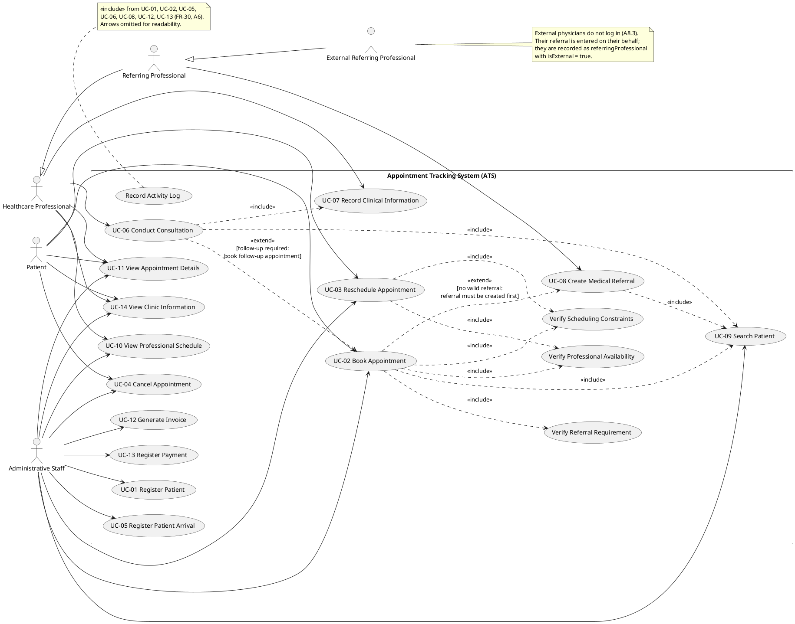

# Reference Draft 01 — Use-Case Diagram

**System:** Appointment Tracking System (ATS) — SOEN 342, Fall 2026, Iteration 1
**Deliverable covered:** Use-case diagram, including critical and non-critical
use cases (iter1.pdf, Deliverables #1).
**Sources:** Use cases, actors and FRs are taken exactly from
`docs/iteration-1/requirement.md` #2, #3, #5. Status words and business rules
come from reference draft 00 (assumptions A2–A8).

---

## 1. System boundary

The boundary is the ATS software (CLI application, CON-01). Everything inside
the rectangle in the diagram is software behaviour. RAMQ, pharmacies and
provincial systems are **outside** the boundary and are not actors (A8.1,
CON-03). An external referring physician is also outside the boundary: they
never log in — their referral is entered by clinic staff / an internal
professional on their behalf (A8.3). They are still drawn as an actor for
UC-08 because the use case exists because of them, with the association going
through the entering user in practice; this is explained in §4.

## 2. Actors (from requirement.md #2, resolved)

| Actor in diagram | Resolves requirement.md §2 entry | Notes |
|---|---|---|
| `Patient` | Patient | Requests/books own appointments; views own invoices (A5). |
| `Administrative Staff` | Administrative Staff | Registration, appointments, arrivals, invoices, payments. No clinical access (FR-29). |
| `Healthcare Professional` | Healthcare Professional **and** Authorized Clinical User | In the diagram these are one actor with clinical authorisation: requirement.md defines Authorized Clinical User as “a healthcare professional with permission…”, i.e. a role of Healthcare Professional, not a separate kind of person. Role/permission differences are enforced by FR-28 and recorded in the domain model (file 02, `SystemUser.role`), rather than by a second stick figure doing the same use cases twice. |
| `Referring Professional` | Referring Professional | Generalisation shown in the diagram: a Healthcare Professional *as referrer*, and an `External Referring Professional` who does not practise at the clinic (FR-23). |

## 3. Use-case list

### 3.1 Critical use cases (requirement.md §5.1)

| ID | Use case | Primary actor (diagram) | Main FRs |
|---|---|---|---|
| UC-01 | Register Patient | Administrative Staff | FR-01–FR-04 |
| UC-02 | Book Appointment | Administrative Staff / Patient | FR-09–FR-13 |
| UC-03 | Reschedule Appointment | Administrative Staff / Patient | FR-14 |
| UC-04 | Cancel Appointment | Administrative Staff / Patient | FR-15 |
| UC-05 | Register Patient Arrival | Administrative Staff | FR-16 |
| UC-06 | Conduct Consultation | Healthcare Professional | FR-17, FR-19, FR-20 |
| UC-07 | Record Clinical Information | Healthcare Professional | FR-18 |
| UC-08 | Create Medical Referral | Healthcare Professional (as Referring Professional) | FR-21–FR-24 |

### 3.2 Non-critical use cases (requirement.md §5.2)

| ID | Use case | Primary actor (diagram) | Main FRs |
|---|---|---|---|
| UC-09 | Search Patient | Administrative Staff | FR-03 |
| UC-10 | View Professional Schedule | Administrative Staff / Healthcare Professional | FR-05–FR-08 |
| UC-11 | View Appointment Details | Administrative Staff / Healthcare Professional / Patient (own only) | FR-09–FR-15 |
| UC-12 | Generate Invoice | Administrative Staff (only — A5) | FR-25, FR-26 |
| UC-13 | Register Payment | Administrative Staff (only — A5) | FR-27 |
| UC-14 | View Clinic Information | Any actor | FR-05–FR-08 (read-only) |

### 3.3 Supporting (included) use cases drawn in the diagram

These are not numbered in requirement.md; they are behaviour factored out
because two or more numbered use cases reuse it, which is exactly what
`<<include>>` is for. They are drawn inside the boundary but flagged here so
nobody mistakes them for new UC numbers.

| Supporting use case | Included by | Why it exists |
|---|---|---|
| Verify Professional Availability | UC-02, UC-03 | FR-10 check reused by booking and rescheduling. |
| Verify Scheduling Constraints | UC-02, UC-03 | FR-11 / A2 rules 1–6, distinct from raw availability. |
| Verify Referral Requirement | UC-02 | FR-12 / A3–A4; only specialist first visits trigger it, but the check itself always runs. |
| Search Patient *(= UC-09 itself)* | UC-02, UC-06, UC-08 | Booking, consultation and referral all start by identifying the patient (A8.5). Drawn as an include of the numbered UC-09, not a duplicate. |
| Record Activity Log | UC-01, UC-02, UC-05, UC-06, UC-08, UC-12, UC-13 | FR-30 / A6 cross-cutting behaviour. Shown once in PlantUML notes to keep the diagram readable; the includes are listed here. |

## 4. PlantUML use-case diagram (source)

## 5. Explanation of every include / extend

**Includes (mandatory, always happen when the base use case runs):**

- **UC-02 / UC-03 `<<include>>` Verify Professional Availability** — neither
  booking nor rescheduling can complete without the FR-10 availability check,
  so it is an include, not an extend.
- **UC-02 / UC-03 `<<include>>` Verify Scheduling Constraints** — the A2 rules
  (working schedule, no double-booking for professional *or* patient, slot
  duration, booking window, location consistency) are likewise unconditional.
  Kept separate from availability because FR-10 and FR-11 are separate
  requirements and fail for different reasons in UC-02's extensions.
- **UC-02 `<<include>>` Verify Referral Requirement** — the *check* always
  runs; the *outcome* differs (A3: most services need no referral). An include
  models “always check”, whereas an extend would wrongly imply the check is
  occasional.
- **UC-02, UC-06, UC-08 `<<include>>` UC-09 Search Patient** — all three
  detailed use cases begin by identifying an existing patient (A8.5). Reusing
  the numbered UC-09 instead of inventing three private “find patient” steps
  keeps the diagram and file 06's operation list consistent: one operation,
  `searchPatient(...)`, serves all three.
- **UC-06 `<<include>>` UC-07 Record Clinical Information** — a consultation
  that records nothing is not a completed consultation in this system
  (FR-17 + FR-18); recording observations/diagnoses is part of the main
  success scenario of UC-06 (file 04), so UC-07 is included by UC-06 and also
  stands alone for later edits to a clinical record.
- **Record Activity Log** — included by every data-changing or
  patient-data-reading use case per A6; drawn as a note (declared in §3.3)
  because seven more dashed arrows add no information.

**Extends (conditional, happen only when a condition holds):**

- **UC-02 `<<extend>>` by UC-08, condition [no valid referral]** — when Verify
  Referral Requirement fails because the required referral does not exist
  (UC-02 extension 5a, file 03), a referral must be created first. UC-08 is
  not part of normal booking, so this is conditional — an extend, pointing
  from the extending use case (UC-08) to the base (UC-02) in UML notation,
  written in the PlantUML above as `UC02 ..> UC08` with the condition labelled;
  when you redraw this in a graphical tool, keep the condition text with it.
- **UC-06 `<<extend>>` by UC-02, condition [follow-up required]** — FR-20: a
  follow-up appointment is booked only when the professional records a
  follow-up requirement during the consultation (file 04,
  `requestFollowUpAppointment(...)`). Most consultations do not, so booking
  cannot be an include of UC-06.

**Generalisation:** `Referring Professional` is a role a Healthcare
Professional plays for UC-08, and `External Referring Professional`
specialises it (FR-23). Modelling it as generalisation — rather than as an
unrelated fifth person — is what lets file 02's domain model use one
`HealthcareProfessional` class with an `isExternal` flag instead of two
parallel class hierarchies.

## 6. What is deliberately NOT in the diagram

- No RAMQ / pharmacy / provincial-system actors (out of scope, CON-03, A8.1).
- No “System Administrator” actor: requirement.md names no such role, and
  inventing one would add use cases no FR supports.
- No payment-method actors (e.g. a bank): FR-27 is *registering* a payment
  that already happened outside the system, so there is no external payment
  interaction to model in Iteration 1.
