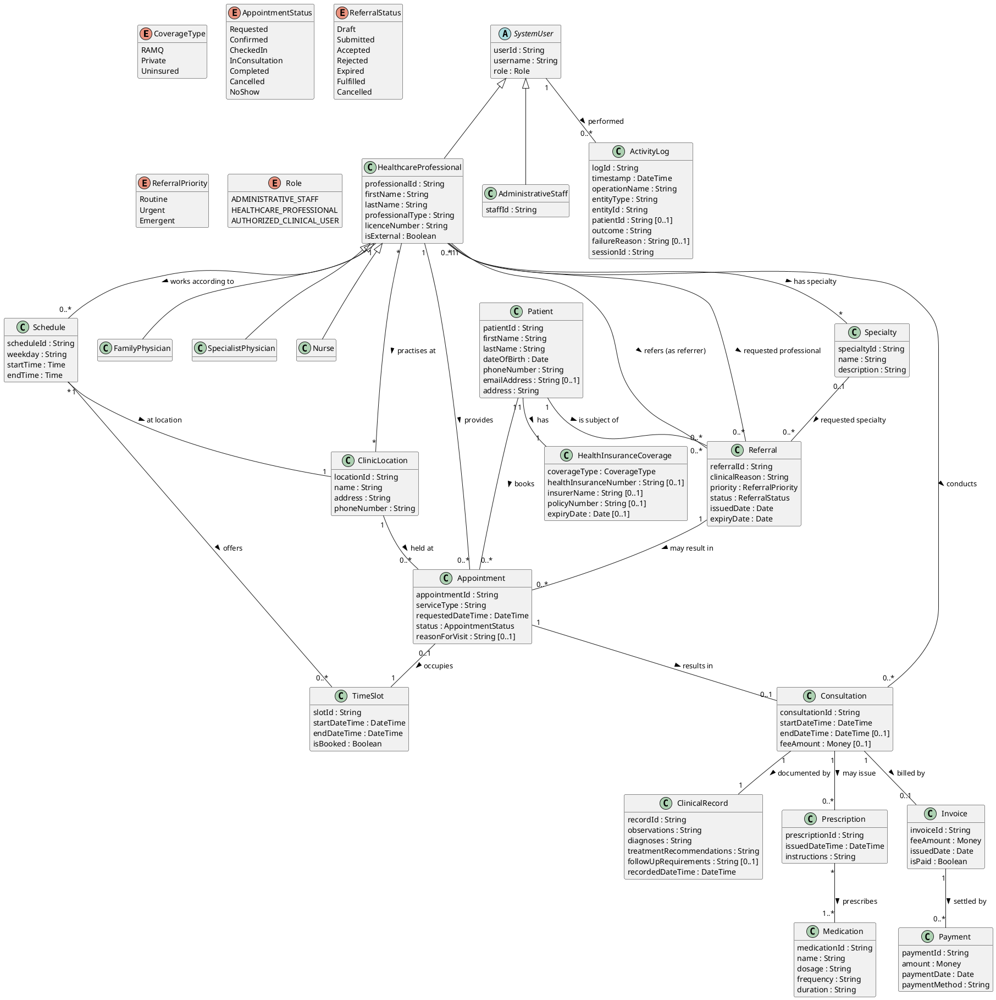

# Reference Draft 02 — UML Domain Model

**System:** Appointment Tracking System (ATS) — SOEN 342, Fall 2026, Iteration 1
**Deliverable covered:** UML domain model (iter1.pdf, Deliverables #2).
**Nature of this model:** *Conceptual* (analysis-level) domain model in the
Larman sense — real-world concepts and their associations, **not** a software
class diagram. Hence: no methods, no navigation arrows, no implementation
types like `List<T>`. Attributes carry simple types only where they clarify
meaning. Names, statuses and rules are exactly those of reference draft 00.

---

## 1. Concept inventory — where each class comes from

| Class | Source in requirement.md / iter1.pdf | One-line responsibility in the domain |
|---|---|---|
| `Patient` | §3.1, FR-01–FR-04 | Person who receives services; uniquely identified (FR-01). |
| `HealthInsuranceCoverage` | FR-04; brief: “covered by RAMQ, or … private insurance” | The patient's coverage arrangement (RAMQ / private / uninsured, A1). |
| `HealthcareProfessional` | §3.2, FR-05 | Family physician, specialist physician, nurse, or other professional. |
| `FamilyPhysician`, `SpecialistPhysician`, `Nurse` | Brief: professionals practise “through family physicians, specialist physicians, nurses, and other healthcare professionals” | Subtypes of `HealthcareProfessional` — needed because A3's referral rule is stated in terms of *specialist* first visits. |
| `Specialty` | FR-06 | A medical specialty a professional holds / a referral requests (e.g. Cardiology). |
| `ClinicLocation` | FR-08, brief: “clinic location” | A physical clinic site where professionals practise. |
| `Schedule` | FR-07 | A professional's recurring/declared working pattern at one location. |
| `TimeSlot` (availability slot) | FR-07, FR-10 | One concrete bookable interval belonging to a schedule block. |
| `Appointment` | §3.3, FR-09–FR-16 | A booked meeting between one patient and one professional at one location/time. |
| `Consultation` | §3.4, FR-17 | The clinical encounter that happens (or should happen) at an appointment. |
| `ClinicalRecord` | §3.4, FR-18 | The clinical information recorded for a consultation: observations, diagnoses, treatment recommendations, follow-up requirements. |
| `Referral` *(ConsultationRequest)* | §3.5, FR-21–FR-24 | A request from a referring professional to a specialty/professional. The brief uses both names for the same concept — one class, two labels, never two classes. |
| `Prescription` | §3.4, FR-19 | An order for one or more medications arising from a consultation. |
| `Medication` | §3.4, FR-19 | A medication that can appear on prescriptions. |
| `Invoice` | §3.6, FR-26 | A bill for an uninsured service (A5). |
| `Payment` | §3.6, FR-27 | Money registered against an invoice. |
| `SystemUser` | §3.7, FR-28 | A login identity with a role, used for access control and logging. |
| `AdministrativeStaff` | §2, FR-29 | A `SystemUser` specialisation performing registration/billing work. |
| `ActivityLog` | §3.7, FR-30, A6 | One auditable entry per relevant system activity. |

`Authorized Clinical User` (§2) is **not** a separate class: it is
`HealthcareProfessional` *in the role of* an authorised clinical user, modelled
as `SystemUser.role = AUTHORIZED_CLINICAL_USER` where a separate login
identity is needed, and otherwise as the professional themselves. See §4.4.

---

## 2. PlantUML conceptual class diagram (source)

*Note on the diagram source:* `HealthcareProfessional` appears both as a domain
concept and (by generalisation) as a kind of `SystemUser`. In PlantUML that is
rendered as one class with two parents shown in §2 (`SystemUser <|--
HealthcareProfessional`). When redrawing in a graphical UML tool, keep it as a
single class — duplicating it into “professional-as-person” and
“professional-as-user” classes would break the traceability in §4.

---

## 3. Explanation of key associations and multiplicities

**Patient 1 — 1 HealthInsuranceCoverage.** Every registered patient has exactly
one current coverage arrangement (A1 makes `coverageType` mandatory), and a
coverage record belongs to exactly one patient. `healthInsuranceNumber` is
`[0..1]` on the coverage, not on Patient, precisely because A1 makes it
mandatory only for RAMQ/Private — an `Uninsured` coverage legitimately has
none. Moving it onto Coverage is what makes that business rule visible in the
model instead of hiding it in a footnote.

**Patient 1 — 0..\* Appointment; HealthcareProfessional 1 — 0..\* Appointment;
ClinicLocation 1 — 0..\* Appointment.** An appointment is the association-like
event tying exactly one patient, one professional and one location together
(FR-09). Zero on the right for all three: a newly registered patient, a new
professional and a new location all exist before any appointment does.

**HealthcareProfessional \* — \* Specialty; \* — \* ClinicLocation.** Directly
FR-06 and FR-08 (“may practise at one or more clinic locations” — and, by the
same wording for specialties, may hold more than one; a specialty is held by
many professionals). Both are many-to-many with no extra attributes worth a
separate association class at analysis level.

**HealthcareProfessional 1 — 0..\* Schedule; Schedule \* — 1 ClinicLocation;
Schedule 1 — 0..\* TimeSlot; Appointment 0..1 — 1 TimeSlot.** A schedule block
is always *at one location* — this is what makes A2 rule 1 and rule 6
checkable (“the professional was working at that location at that time”). A
`TimeSlot` is a concrete interval cut from a schedule block (A8.4). An
appointment occupies exactly one slot; a slot is occupied by at most one
appointment at a time (`0..1` on the Appointment end) — that single
multiplicity *is* the no-double-booking rule for the professional (A2 rule 2)
in model form. Patient double-booking (A2 rule 3) cannot be expressed by a
multiplicity and is therefore stated as a constraint in UC-02's contract
(file 03), which is the correct Larman place for it.

**Appointment 1 — 0..1 Consultation.** Not every appointment produces a
consultation — cancelled and no-show appointments never do — hence `0..1`, and
this multiplicity is why `startConsultation(...)` must check status
`CheckedIn` first (file 04).

**Consultation 1 — 1 ClinicalRecord; Consultation 1 — 0..\* Prescription;
Prescription \* — 1..\* Medication.** A completed consultation has exactly one
clinical record (UC-06 includes UC-07, file 01 §5); amendments update that
record rather than multiplying it. Prescriptions are optional (`0..*`) and,
when present, must name **at least one** medication (`1..*` on the Medication
end) — FR-19's “one or more medications”. An empty prescription cannot exist
in this model, which file 04's `issuePrescription(...)` contract states as a
precondition.

**Referral associations (the most important part of this model).**
- `HealthcareProfessional 1 — 0..* Referral` as *referrer*: the referring
  professional of FR-22. For external referrers this is a
  `HealthcareProfessional` with `isExternal = true` who has no `SystemUser`
  login (A8.3) — the model records who they are without pretending they use
  the system.
- `Patient 1 — 0..* Referral`: the patient the referral is *about*.
- `Specialty 0..1 — Referral` and `HealthcareProfessional 0..1 — Referral`
  (requested professional): FR-22 says “requested specialty **or**
  professional”, so both ends are optional individually, with the constraint
  (stated in file 05's contracts) that **at least one of the two must be
  present**. Writing both as mandatory would contradict the brief; writing
  both as optional *without* the constraint would allow a referral to
  nowhere.
- `Referral 1 — 0..* Appointment`: FR-24 verbatim — one referral may result in
  one or more appointments, and may exist (e.g. `Submitted`, `Rejected`) with
  none.

**Consultation 1 — 0..1 Invoice; Invoice 1 — 0..\* Payment.** Invoices exist
only for uninsured services (A5, FR-25), so most consultations have none:
`0..1`. Several payments may settle one invoice (part-payments), and
`Invoice.isPaid` is derivable from whether payments sum to `feeAmount` — it is
kept as an attribute because UC-13's users need it at a glance, with the
derivation noted here so nobody treats it as independent data.

**SystemUser 1 — 0..\* ActivityLog.** Every log entry records the user who
performed the operation (A6). Patient-access auditing additionally uses
`ActivityLog.patientId [0..1]` — present exactly when patient data was touched.

## 4. Design decisions and how the FRs map

### 4.1 Generalisations
- `FamilyPhysician`, `SpecialistPhysician`, `Nurse` specialise
  `HealthcareProfessional`. Only one rule in the whole brief distinguishes
  them — A3's referral-required rule for *specialist* first visits — so the
  subtypes carry no extra attributes in Iteration 1. They exist so the rule
  (and file 03's referral check) can be stated over a type, not over a free-text
  `professionalType` string; both are shown, and in your own redraw pick one
  mechanism and delete the other to avoid duplication.
- `AdministrativeStaff` and `HealthcareProfessional` specialise `SystemUser`,
  giving FR-28/FR-29 one place (`role`) to attach permissions.

### 4.2 What was *not* made a class, and why
- **Availability** is not a class: it is derived from `Schedule` + `TimeSlot`
  + existing `Appointment`s. A separate Availability class would duplicate
  the slot data. (`TimeSlot` is the “AvailabilitySlot” concept.)
- **Fee** is not a class: it is `Consultation.feeAmount [0..1]` (present only
  for uninsured services) copied onto `Invoice.feeAmount` at billing (A5).
- **Diagnosis / Observation** are not classes: FR-18 lists them as *contents*
  of the clinical information, so they are attributes of `ClinicalRecord`.
  Splitting them out would be design, not analysis.

### 4.3 FR → model traceability (summary)

| FRs | Model element(s) |
|---|---|
| FR-01–FR-04 | `Patient.patientId` + uniqueness (A1); `HealthInsuranceCoverage`, `CoverageType` |
| FR-05–FR-08 | `HealthcareProfessional`, `Specialty`, `Schedule`/`TimeSlot`, `ClinicLocation` (\*—\* practises-at) |
| FR-09–FR-16 | `Appointment` + its 3 associations; `status` = `AppointmentStatus` (A7.1); `TimeSlot` occupancy (A2) |
| FR-17–FR-20 | `Consultation`, `ClinicalRecord`, `Prescription`—`Medication`, follow-up via `Appointment` created from a consultation (file 04) |
| FR-21–FR-24 | `Referral` + referrer / patient / requested-specialty / requested-professional / resulting-appointment associations |
| FR-25–FR-27 | `Consultation.feeAmount`, `Invoice`, `Payment` (A5 roles enforced at operation level, files 03–06) |
| FR-28–FR-30 | `SystemUser.role`, `AdministrativeStaff` specialisation, `ActivityLog` (A6) |
| NFR-01/02, CON-01–03 | No classes — constraints on the whole model; honoured by A6 logging rule and by keeping RAMQ/pharmacy systems out of the model (A8.1) |

### 4.4 Authorized Clinical User
Treated as `Role.AUTHORIZED_CLINICAL_USER` on `SystemUser`, normally held by a
`HealthcareProfessional`. In contracts (files 04–05) “authorised clinical user”
checks are written as role checks, so an administrative user can never satisfy
them — that is FR-29 expressed operationally.
