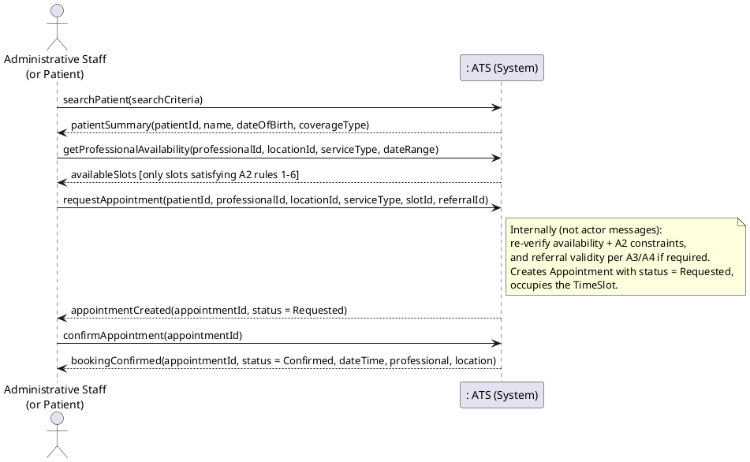
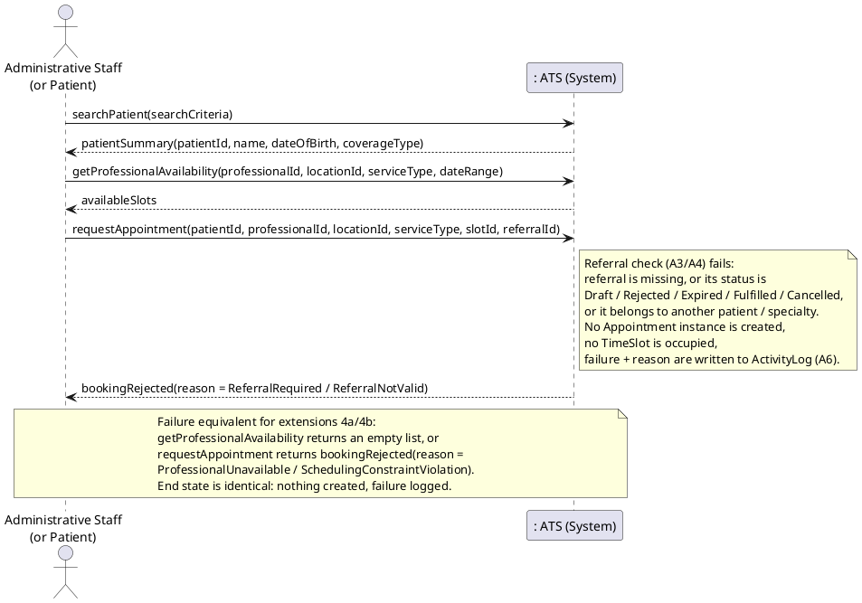

# Reference Draft 03 — UC-02 Book Appointment

**Deliverables covered:** Fully dressed scenario (success + failure), system
sequence diagrams for success and failure, system operations and operation
contracts (iter1.pdf, Deliverables #3–#5).
**Consistency anchors:** Actors/FRs from requirement.md §3.3/§5.1; rules A2
(scheduling), A3 (referral-required services), A4 (referral validity), A6
(logging), A7.1 (appointment statuses), A8.5 (search) from draft 00; concepts
from the domain model, draft 02.
**Operation names in this file are canonical** — draft 06 reuses them unchanged.

---

## Part 1 — Fully dressed use case

| Field | Content |
|---|---|
| **Use Case ID** | UC-02 |
| **Name** | Book Appointment |
| **Scope** | Appointment Tracking System (ATS) — clinic appointment management |
| **Level** | User goal |
| **Primary Actor** | Administrative Staff; Patient may initiate the same flow for themselves (requirement.md §5.1 lists both). Contracts below are written actor-neutrally except where role matters. |
| **Stakeholders and Interests** | **Patient:** gets an appointment at a workable time, with the right professional, without travelling to a slot that cannot serve them. **Administrative Staff:** booking is fast and cannot create double-bookings they will have to untangle. **Healthcare Professional:** appointments respect their schedule and location, with referrals in place where required. **Clinic:** scheduling, referral and access rules are enforced uniformly and every booking is auditable (FR-30). |
| **Preconditions** | 1. Actor is authenticated as a `SystemUser` with role `ADMINISTRATIVE_STAFF`, or as the Patient booking for themselves. 2. The patient is registered (UC-01) — otherwise extension 7a. 3. The requested professional, specialty and clinic location exist in the system (FR-05–FR-08). |
| **Success Guarantee (Postconditions)** | 1. An `Appointment` exists linking exactly one `Patient`, one `HealthcareProfessional` and one `ClinicLocation`, with `status = Confirmed`. 2. Exactly one `TimeSlot` is occupied by that appointment; neither the professional nor the patient has an overlapping active appointment. 3. If the service required a referral (A3), the appointment is associated with a referral that was valid at booking time (A4). 4. An `ActivityLog` entry records the booking (A6). |
| **Minimal Guarantee** | No partial booking is left behind: if any check fails, no `Appointment` remains in a blocking status, no `TimeSlot` stays occupied, and the failure (with reason) is recorded in the `ActivityLog`. |
| **Trigger** | Patient or Administrative Staff ask to book an appointment for a patient. |
| **Main Success Scenario** | See below. |
| **Extensions (Failures / Alternatives)** | See below: 4a professional unavailable, 4b scheduling-constraint violation, 5a–5c referral failures, 7a patient not found. |
| **Special Requirements** | FR-10, FR-11, FR-12 (the three verifications); NFR-01/NFR-02 (role check + logging); times to the minute (A8.4). |
| **Technology / Data Variations** | CLI entry (CON-01). Search criteria may be any FR-03 key (A8.5). |
| **Frequency** | Many times per clinic day. |
| **Open Issues** | None remaining for this use case — A2–A4 resolved the §6 questions it depends on. |

### Main Success Scenario

1. The actor asks to book an appointment and identifies the patient
   (system operation: `searchPatient(...)` if a lookup is needed first).
2. The system confirms the patient exists and displays the patient's identity
   summary (name, date of birth, coverage type — clinical data is never shown
   to Administrative Staff, FR-29).
3. The actor selects the service type, the healthcare professional (or a
   specialty, from which the system lists professionals) and the clinic
   location, and asks for availability in a date range
   (`getProfessionalAvailability(...)`).
4. The system returns only `TimeSlot`s that satisfy A2 rules 1–6 for that
   professional, location and service type.
5. The actor selects a slot and submits the booking, supplying a `referralId`
   if the service requires a referral (`requestAppointment(...)`).
6. The system verifies availability and scheduling constraints again at
   submission time, and — because the service requires a referral (A3) —
   verifies that the supplied referral is valid for this patient, specialty
   and date (A4).
7. The system creates the `Appointment` with `status = Requested`, associates
   it with the patient, professional, location, slot and (where applicable)
   referral, and marks the slot booked.
8. The actor confirms the booking (`confirmAppointment(...)`).
9. The system sets the appointment's `status = Confirmed`, records an
   `ActivityLog` entry, and displays the confirmation (appointment ID, date,
   time, professional, location).

### Extensions

**4a. Professional unavailable in the requested range**
- 4a1. `getProfessionalAvailability(...)` returns no slot (professional fully
  booked, or not scheduled at that location on those days — A2 rules 1–2).
- 4a2. The system says so, distinguishing “not working then” from “fully
  booked”. The actor picks another professional, location or date range and
  resumes at step 3. *No appointment instance is created in this extension.*

**4b. Scheduling-constraint violation on a slot that looked free**
- 4b1. The only apparently free slots violate A2 rule 3 (patient already has
  an overlapping appointment), rule 4 (slot duration does not match the
  service type) or rule 5 (past / more than 90 days ahead).
- 4b2. The system excludes those slots and states *which* constraint removed
  them. Flow resumes at step 4 with corrected choices.

**5a. Referral required but missing**
- 5a1. At step 6 the service requires a referral (A3 — e.g. first visit to a
  Specialist Physician for that specialty) and no `referralId` was supplied,
  and no other valid referral exists for this patient + specialty.
- 5a2. The system rejects the request with reason `ReferralRequired`, creates
  **no** appointment, releases nothing (nothing was reserved), and logs the
  failure (A6).
- 5a3. The actor is told a referral must be created first (UC-08; see the
  `<<extend>>` relationship in draft 01 §5). The use case ends in failure for
  this attempt.

**5b. Referral supplied but invalid — wrong patient / wrong specialty /
wrong professional**
- 5b1. The supplied referral fails A4 rule 3 or rule 4.
- 5b2. Same handling as 5a2, with reason `ReferralNotValid` and a message
  identifying which match failed. Ends in failure.

**5c. Referral expired, rejected, cancelled or still a draft**
- 5c1. The supplied referral fails A4 rule 1 or rule 2 (status `Draft`,
  `Rejected`, `Expired`, `Fulfilled` or `Cancelled`, or past `expiryDate`).
- 5c2. Same handling as 5a2, reason `ReferralNotValid`, message naming the
  referral's actual status. Ends in failure. (This is the failure case shown
  in the failure SSD below.)

**7a. Patient not found**
- 7a1. `searchPatient(...)` returns no match (or several matches and the
  actor selects none, A8.5).
- 7a2. If the patient was never registered, the actor is directed to UC-01
  Register Patient. This use case ends; no booking is attempted, and the
  search itself is logged if it used patient-identifying criteria (A6).

**8a. Actor abandons confirmation**
- 8a1. The actor does not confirm. The appointment remains `Requested` for
  this session only in the sense defined by the `confirmAppointment(...)`
  contract: an unconfirmed `Requested` appointment does **not** hold its
  slot against other bookings after the session ends; the slot association
  is released and the abandonment is logged. (This rule is stated here so the
  diagram, scenario and contract cannot drift apart.)

---

## Part 2 — System Sequence Diagrams (system as black box)

In an SSD the system is one lifeline; only actor↔system messages are system
operations. The A2/A4 *verifications are internal system responsibilities*
triggered inside `requestAppointment(...)`, not separate actor messages —
that is why they appear as SSD notes, not arrows.

### 2.1 SSD — Success scenario

### 2.2 SSD — Failure scenario (referral required but invalid/expired; covers extensions 5a–5c)

### 2.3 System operations visible in these SSDs

| # | Operation | Appears in |
|---|---|---|
| OP-02-1 | `searchPatient(searchCriteria)` | Success + failure (shared with UC-06, UC-08 — same name/signature in drafts 04–06) |
| OP-02-2 | `getProfessionalAvailability(professionalId, locationId, serviceType, dateRange)` | Success + failure |
| OP-02-3 | `requestAppointment(patientId, professionalId, locationId, serviceType, slotId, referralId [0..1])` | Success + failure |
| OP-02-4 | `confirmAppointment(appointmentId)` | Success only |

---

## Part 3 — Operation contracts (Larman style)

### Contract CO-02-1: `searchPatient`

| Field | Content |
|---|---|
| **Operation** | `searchPatient(searchCriteria)` — where `searchCriteria` is one of: health insurance number, date of birth, phone number, partial first name and/or partial last name (FR-03) |
| **Cross-References** | UC-02 (also UC-09, UC-06, UC-08); FR-03, FR-28, FR-30 |
| **Preconditions** | Actor is authenticated; actor's role permits patient lookup (`ADMINISTRATIVE_STAFF`, `HEALTHCARE_PROFESSIONAL` / `AUTHORIZED_CLINICAL_USER`, or the Patient searching only for themselves). |
| **Postconditions** | – No domain instance was created, deleted or modified (read-only operation). – The matching `Patient` summaries (identity fields only, no clinical data) were returned; if several patients match (A8.5), all matches are returned for actor selection. – An `ActivityLog` entry was created recording actor, criteria type, number of matches and `outcome = Success`, with `patientId` set when exactly one patient matched (A6). |

### Contract CO-02-2: `getProfessionalAvailability`

| Field | Content |
|---|---|
| **Operation** | `getProfessionalAvailability(professionalId, locationId, serviceType, dateRange)` |
| **Cross-References** | UC-02, UC-03, UC-10; FR-07, FR-08, FR-10, FR-11 |
| **Preconditions** | A `HealthcareProfessional` with `professionalId` exists; a `ClinicLocation` with `locationId` exists; the professional practises at that location (otherwise the result is legitimately empty — extension 4a, not an error of the operation). |
| **Postconditions** | – No domain instance was created, deleted or modified. – The returned set contains exactly the `TimeSlot`s of that professional's `Schedule` at that location, inside `dateRange`, whose duration matches `serviceType` (A2 rule 4) and which are not occupied by an appointment in status `Requested` (still session-held), `Confirmed`, `CheckedIn` or `InConsultation` (A2 rules 1, 2, 5). |

### Contract CO-02-3: `requestAppointment`

| Field | Content |
|---|---|
| **Operation** | `requestAppointment(patientId, professionalId, locationId, serviceType, slotId, referralId [0..1])` |
| **Cross-References** | UC-02; FR-09, FR-10, FR-11, FR-12, FR-13 |
| **Preconditions** | 1. A `Patient` with `patientId`, a `HealthcareProfessional` with `professionalId`, and a `TimeSlot` with `slotId` all exist. 2. The slot belongs to that professional's schedule at `locationId`. 3. At submission time the slot still satisfies A2 rules 1–6 (re-verified inside the operation — availability shown earlier is not a guarantee). 4. If `serviceType` requires a referral (A3), a `referralId` is supplied **or** another referral exists that is valid for this patient/specialty/date under A4. |
| **Postconditions (success)** | – An `Appointment` instance `a` was created. – `a` was associated with exactly one `Patient`, one `HealthcareProfessional`, one `ClinicLocation` and the chosen `TimeSlot`. – `a.status` became `Requested` (A7.1). – `a.serviceType` became the requested service type. – The `TimeSlot.isBooked` became `true` (slot held for this appointment). – If a referral was required, `a` was associated with the valid `Referral` used; the referral's own status was **not** changed (A4 rule 5 — referrals are not consumed by booking). – An `ActivityLog` entry was created (`outcome = Success`, A6). |
| **Postconditions (failure)** | – No `Appointment` was created and no `TimeSlot` changed state (minimal guarantee). – An `ActivityLog` entry was created with `outcome = Failure` and `failureReason` one of `ProfessionalUnavailable`, `SchedulingConstraintViolation`, `ReferralRequired`, `ReferralNotValid`. |

### Contract CO-02-4: `confirmAppointment`

| Field | Content |
|---|---|
| **Operation** | `confirmAppointment(appointmentId)` |
| **Cross-References** | UC-02; FR-13 |
| **Preconditions** | An `Appointment` with `appointmentId` exists with `status = Requested`, created in the actor's current workflow; its slot is still held for it and still satisfies A2. |
| **Postconditions** | – The appointment's `status` became `Confirmed` (A7.1). – The association to its `TimeSlot` (already created by CO-02-3) was retained; the slot remains booked, now permanently until cancellation/completion. – An `ActivityLog` entry recording the confirmation was created (A6). – If confirmation does not occur, extension 8a applies: the `Requested` appointment ceases to hold the slot at session end and the release is logged. |
