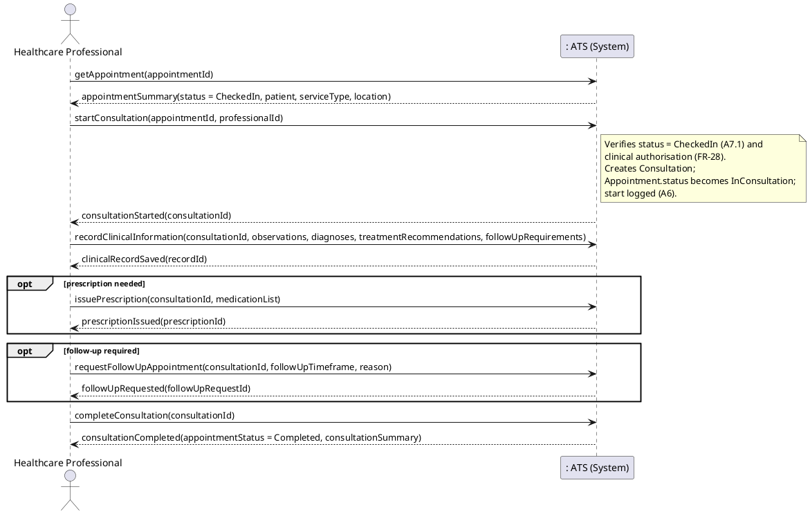
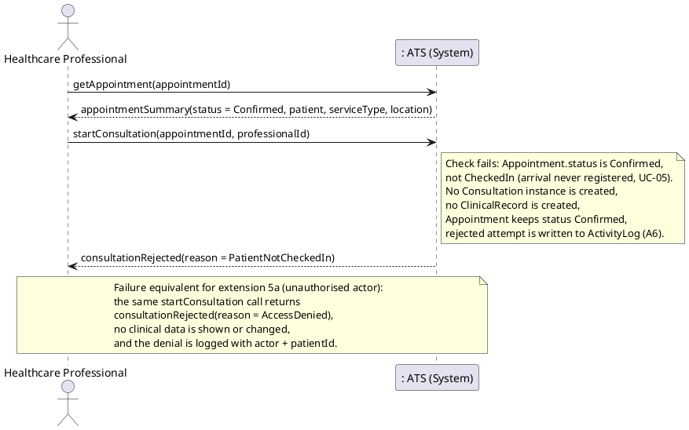

# Reference Draft 04 — UC-06 Conduct Consultation

**Deliverables covered:** Fully dressed scenario (success + failure), SSDs for
success and failure, system operations and operation contracts (iter1.pdf,
Deliverables #3–#5).
**Consistency anchors:** FR-17–FR-20, FR-28–FR-30 (requirement.md §3.4, §3.7);
A5 (fee basis — professional records it, staff bill it), A6 (logging),
A7.1 (appointment statuses), from draft 00; concepts from draft 02.
UC-06 *includes* UC-07 Record Clinical Information (draft 01 §5).
**Operation names are canonical** — draft 06 reuses them unchanged.

---

## Part 1 — Fully dressed use case

| Field | Content |
|---|---|
| **Use Case ID** | UC-06 |
| **Name** | Conduct Consultation |
| **Scope** | Appointment Tracking System (ATS) — clinical consultation and recording |
| **Level** | User goal |
| **Primary Actor** | Healthcare Professional (acting as Authorized Clinical User for clinical data, FR-28) |
| **Stakeholders and Interests** | **Patient:** receives care; their clinical information is recorded accurately and seen only by authorised professionals (NFR-01). **Healthcare Professional:** can record observations, diagnoses, treatment and follow-up efficiently, and issue prescriptions / follow-ups in the same flow. **Clinic / Administrative Staff:** the appointment is closed out correctly so billing for uninsured services (A5) and scheduling of follow-ups can proceed. **Regulators / clinic management (via audit):** every access to clinical information is attributable (FR-30, A6). |
| **Preconditions** | 1. Actor is authenticated with role `HEALTHCARE_PROFESSIONAL` / `AUTHORIZED_CLINICAL_USER`. 2. An `Appointment` exists for the patient with `status = CheckedIn` (arrival registered in UC-05, FR-16). 3. The actor is the professional assigned to that appointment, or is otherwise authorised for that patient's clinical information (FR-28). |
| **Success Guarantee (Postconditions)** | 1. A `Consultation` exists for the appointment, conducted by the actor, and the appointment's `status = Completed`. 2. Exactly one `ClinicalRecord` for that consultation contains observations, diagnoses, treatment recommendations and (if any) follow-up requirements (FR-18). 3. Any `Prescription` issued names ≥ 1 `Medication` (FR-19). 4. Any follow-up requirement that needs an appointment has produced a follow-up booking request (FR-20). 5. If the service was uninsured, the fee basis (`Consultation.feeAmount`) is recorded for Administrative Staff to invoice (A5). 6. `ActivityLog` entries record the consultation and every clinical-data access (A6). |
| **Minimal Guarantee** | If the consultation cannot start, no `Consultation` or `ClinicalRecord` is created and the appointment keeps its prior status. If it cannot complete, work already recorded stays attached to a consultation in progress (appointment `InConsultation`) rather than being lost or marked completed falsely; the failure is logged. |
| **Trigger** | The healthcare professional begins the consultation for a checked-in patient. |
| **Main Success Scenario** | See below. |
| **Extensions** | 4a appointment not found / wrong status, 4b patient not arrived, 5a actor not authorised, 8a prescription with no medication, 9a follow-up requested. |
| **Special Requirements** | NFR-01 confidentiality: Administrative Staff must never satisfy this use case's authorisation checks (FR-29). A6: denied attempts are logged, not silently dropped. |
| **Frequency** | Once per completed appointment. |

### Main Success Scenario

1. The professional opens the appointment for today's patient
   (`getAppointment(appointmentId)`).
2. The system displays the appointment summary (patient identity, service
   type, time, location, linked referral if any). It does not display other
   patients' data.
3. The professional starts the consultation (`startConsultation(appointmentId,
   professionalId)`).
4. The system verifies the appointment's `status = CheckedIn` and the actor's
   clinical authorisation, creates a `Consultation`, sets the appointment's
   `status = InConsultation`, and logs the start (A6).
5. The professional records the clinical information — observations,
   diagnoses, treatment recommendations, and follow-up requirements if any
   (`recordClinicalInformation(...)`) — this is UC-07, included here.
6. The system stores it as the consultation's single `ClinicalRecord`,
   attributed to the professional and timestamped.
7. Where appropriate, the professional issues a prescription naming one or
   more medications (`issuePrescription(...)`, extension 7 is optional —
   step may be skipped or repeated).
8. Where a follow-up is required, the professional requests a follow-up
   appointment (`requestFollowUpAppointment(...)`, optional, see extension
   9a).
9. The professional completes the consultation (`completeConsultation(...)`).
10. The system sets the appointment's `status = Completed`, records the
    consultation end time, records the fee basis if the service is uninsured
    (A5), logs completion, and displays the consultation summary.

### Extensions

**4a. Appointment not found, or in the wrong status**
- 4a1. `getAppointment(...)` finds nothing, or `startConsultation(...)` finds
  `status` is `Requested`/`Confirmed` (not yet arrived), `Completed`,
  `Cancelled` or `NoShow`.
- 4a2. The system rejects the start with the appointment's actual status as
  the reason. No `Consultation` is created. Ends in failure (or, for
  `Confirmed`, see 4b).

**4b. Patient has not arrived / not checked in** *(the required failure case)*
- 4b1. The appointment is `Confirmed` but arrival was never registered
  (UC-05 / FR-16 never ran), so `status ≠ CheckedIn`.
- 4b2. `startConsultation(...)` is rejected with reason
  `PatientNotCheckedIn`. The system tells the professional the patient must
  be registered as arrived by Administrative Staff first.
- 4b3. No `Consultation` or `ClinicalRecord` is created; the appointment
  stays `Confirmed`; the rejected attempt is logged (A6). The use case ends
  in failure for this attempt. (Shown in the failure SSD.)

**5a. Actor not authorised for clinical information**
- 5a1. The actor is not the assigned professional and holds no authorisation
  for this patient's clinical information, or the actor's role is
  `ADMINISTRATIVE_STAFF` (FR-29 — administrative access never includes
  clinical access).
- 5a2. Any of `startConsultation(...)`,
  `recordClinicalInformation(...)` or `issuePrescription(...)` is rejected
  with `outcome = AccessDenied`.
- 5a3. **No clinical data is displayed or modified.** The denial, the actor
  and the patient involved are written to the `ActivityLog` (A6) — a denied
  attempt is exactly what the log exists to catch. Ends in failure.

**8a. Prescription submitted with no medication**
- 8a1. `issuePrescription(...)` is called with an empty medication list,
  violating FR-19's “one or more medications” and the domain model's
  `Prescription * — 1..* Medication` multiplicity (draft 02 §3).
- 8a2. The system rejects it; no `Prescription` instance is created; the
  consultation continues unaffected. The professional corrects the list and
  resumes at step 7.

**9a. Follow-up appointment requested** *(extension by condition, UC-02 `<<extend>>`)*
- 9a1. `recordClinicalInformation(...)` included a follow-up requirement, and
  the professional calls `requestFollowUpAppointment(consultationId,
  followUpTimeframe, reason)`.
- 9a2. The system records the requirement on the `ClinicalRecord` and creates
  a follow-up booking request for the same patient + professional/specialty,
  to be confirmed through UC-02's normal availability/referral checks (A2–A4
  still apply — a follow-up inside a valid referral's validity needs no new
  referral, A3). No slot is promised at this step.

**9b. Uninsured service — fee basis**
- 9b1. If the patient's coverage is `Uninsured` (A1/A5), the professional
  records `feeAmount` for the service rendered before completing.
- 9b2. Generating the invoice itself is UC-12, performed later by
  Administrative Staff only (A5). UC-06 never creates an `Invoice`.

---

## Part 2 — System Sequence Diagrams

### 2.1 SSD — Success scenario

### 2.2 SSD — Failure scenario (patient not checked in; covers extension 4b, with 5a noted)

### 2.3 System operations visible in these SSDs

| # | Operation | Appears in |
|---|---|---|
| OP-06-1 | `getAppointment(appointmentId)` | Success + failure |
| OP-06-2 | `startConsultation(appointmentId, professionalId)` | Success + failure |
| OP-06-3 | `recordClinicalInformation(consultationId, observations, diagnoses, treatmentRecommendations, followUpRequirements [0..1])` | Success |
| OP-06-4 | `issuePrescription(consultationId, medicationList)` | Success (optional) |
| OP-06-5 | `requestFollowUpAppointment(consultationId, followUpTimeframe, reason)` | Success (optional) |
| OP-06-6 | `completeConsultation(consultationId)` | Success |

Patient identification before step 1, when needed, reuses
`searchPatient(searchCriteria)` from UC-02 unchanged (draft 01 §5).

---

## Part 3 — Operation contracts

### Contract CO-06-1: `getAppointment`

| Field | Content |
|---|---|
| **Operation** | `getAppointment(appointmentId)` |
| **Cross-References** | UC-06, UC-11; FR-28, FR-29, FR-30 |
| **Preconditions** | An `Appointment` with `appointmentId` exists; actor is authenticated. If the appointment involves clinical context, actor's role permits seeing it (Administrative Staff see scheduling fields only, FR-29). |
| **Postconditions** | – No instance was created, deleted or modified. – The appointment summary (patient, professional, location, service type, `status`, linked `Referral` if any) was returned, filtered to fields the actor's role may see. – An `ActivityLog` entry recording the access, including `patientId`, was created (A6). |

### Contract CO-06-2: `startConsultation`

| Field | Content |
|---|---|
| **Operation** | `startConsultation(appointmentId, professionalId)` |
| **Cross-References** | UC-06; FR-16, FR-17, FR-28 |
| **Preconditions** | 1. The `Appointment` exists with `status = CheckedIn` (A7.1). 2. The actor is the assigned `HealthcareProfessional` (or otherwise authorised for this patient, FR-28) and is not acting in an `ADMINISTRATIVE_STAFF` role. 3. No other `Consultation` is already in progress for this appointment. |
| **Postconditions (success)** | – A `Consultation` instance `c` was created and associated with the `Appointment` and with the conducting `HealthcareProfessional`. – `c.startDateTime` was set to the current time. – The appointment's `status` became `InConsultation`. – An `ActivityLog` entry (`outcome = Success`, patient identified) was created. |
| **Postconditions (failure)** | – No `Consultation` was created; the appointment's status was unchanged. – An `ActivityLog` entry with `outcome = Failure` (`failureReason = PatientNotCheckedIn` / wrong status) or `outcome = AccessDenied` was created (extensions 4a/4b/5a). |

### Contract CO-06-3: `recordClinicalInformation`

| Field | Content |
|---|---|
| **Operation** | `recordClinicalInformation(consultationId, observations, diagnoses, treatmentRecommendations, followUpRequirements [0..1])` |
| **Cross-References** | UC-06, UC-07; FR-18, FR-28 |
| **Preconditions** | The `Consultation` exists and is in progress (its appointment's `status = InConsultation`); actor is the conducting professional / authorised clinical user for this patient. |
| **Postconditions** | – A `ClinicalRecord` instance was created (or, on a repeat call during the same consultation, the consultation's single existing `ClinicalRecord` was updated — there is never a second record for one consultation, draft 02 §3). – Its `observations`, `diagnoses`, `treatmentRecommendations` and `followUpRequirements` were set from the parameters, and `recordedDateTime` was set. – The `ClinicalRecord` was associated with exactly that `Consultation`. – An `ActivityLog` entry recording *that* clinical information was recorded (not its content, A6) was created. |

### Contract CO-06-4: `issuePrescription`

| Field | Content |
|---|---|
| **Operation** | `issuePrescription(consultationId, medicationList)` — each entry names a medication, dosage, frequency and duration |
| **Cross-References** | UC-06; FR-19, FR-28. *(Electronic transmission to a pharmacy is out of scope, CON-03.)* |
| **Preconditions** | The `Consultation` is in progress; actor is the conducting/authorised professional; `medicationList` contains **at least one** medication (extension 8a). |
| **Postconditions** | – A `Prescription` instance was created, associated with the `Consultation`, with `issuedDateTime` set. – The prescription was associated with the 1..* `Medication` instances from `medicationList` (existing medications reused, new ones created with their dosage/frequency/duration recorded as prescribed). – An `ActivityLog` entry was created (A6). |

### Contract CO-06-5: `requestFollowUpAppointment`

| Field | Content |
|---|---|
| **Operation** | `requestFollowUpAppointment(consultationId, followUpTimeframe, reason)` |
| **Cross-References** | UC-06, UC-02 (extend, draft 01 §5); FR-20 |
| **Preconditions** | The `Consultation` is in progress or just completed by the same professional; a follow-up requirement exists in its `ClinicalRecord` or is supplied as `reason`. |
| **Postconditions** | – The follow-up requirement was recorded/updated on the consultation's `ClinicalRecord.followUpRequirements`. – A follow-up booking request linking the same `Patient` and the professional/specialty was created in a pending state — **no** `TimeSlot` was reserved and **no** `Appointment` was confirmed by this operation; confirmation happens only through UC-02 with A2–A4 checks applied (extension 9a). – An `ActivityLog` entry was created. |

### Contract CO-06-6: `completeConsultation`

| Field | Content |
|---|---|
| **Operation** | `completeConsultation(consultationId)` |
| **Cross-References** | UC-06; FR-17, FR-25 (fee basis), FR-30 |
| **Preconditions** | The `Consultation` is in progress; its `ClinicalRecord` exists with at least observations and diagnoses recorded (CO-06-3 has run); if the service is uninsured, `feeAmount` has been recorded (extension 9b). |
| **Postconditions** | – The consultation's `endDateTime` was set. – Its `Appointment.status` became `Completed` (A7.1). – If uninsured, `Consultation.feeAmount` is set, making the consultation ready for UC-12 invoicing by Administrative Staff (A5) — no `Invoice` was created by this operation. – An `ActivityLog` entry recording completion was created. |
