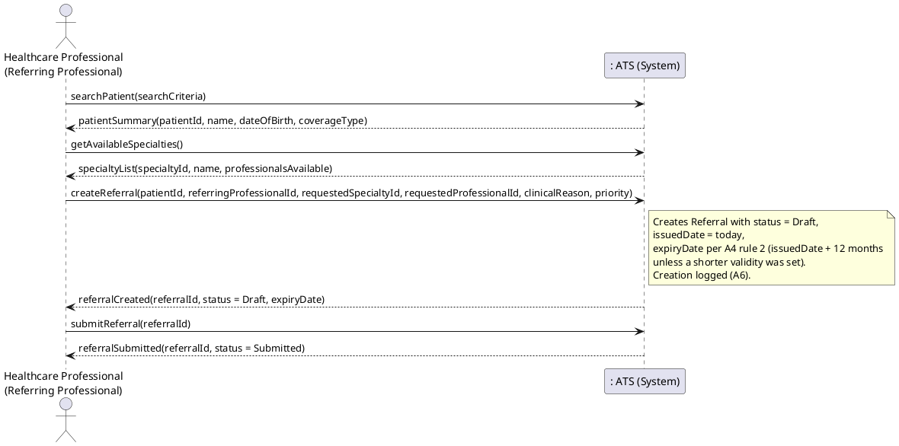
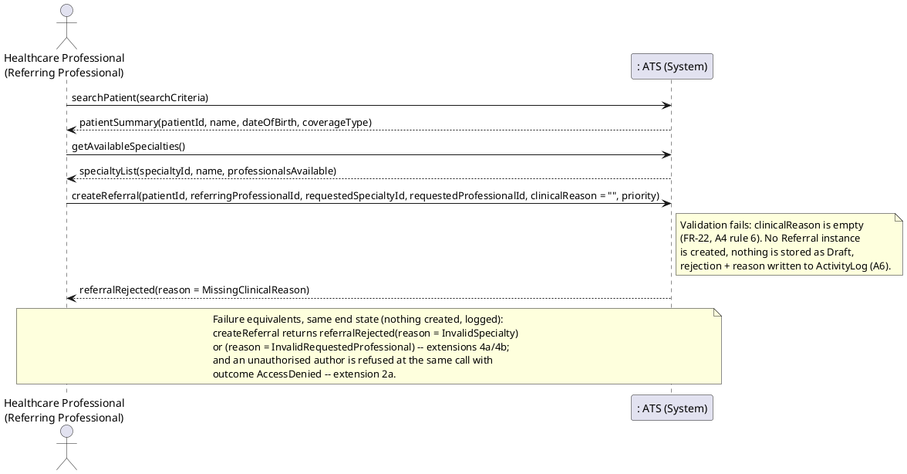

# Reference Draft 05 — UC-08 Create Medical Referral

**Deliverables covered:** Fully dressed scenario (success + failure), SSDs for
success and failure, system operations and operation contracts (iter1.pdf,
Deliverables #3–#5).
**Synonym used throughout the course brief:** referral = *consultation
request*. One concept, one class (`Referral` in draft 02) — never two.
**Consistency anchors:** FR-21–FR-24 (requirement.md §3.5); A3 (which services
need referrals), A4 (validity), A6 (logging), A7.2 (referral statuses),
A7.3 (priorities), A8.3 (external referrers are data, not users) from draft 00.
**Operation names are canonical** — draft 06 reuses them unchanged.

---

## Part 1 — Fully dressed use case

| Field | Content |
|---|---|
| **Use Case ID** | UC-08 |
| **Name** | Create Medical Referral |
| **Scope** | Appointment Tracking System (ATS) — referral / consultation-request management |
| **Level** | User goal |
| **Primary Actor** | Healthcare Professional acting as Referring Professional; for an external physician, a clinic user enters the referral on the external professional's behalf (A8.3) |
| **Stakeholders and Interests** | **Patient:** is referred to the right specialty/professional, with a clear clinical reason, without having to carry paper or re-explain. **Referring Professional:** the referral is recorded completely (FR-22) and its status is trackable afterwards. **Requested Specialist / Professional:** receives enough clinical reason and priority information to accept and prioritise. **Clinic:** referrals are auditable, expire predictably (A4), and gate specialist bookings consistently in UC-02. |
| **Preconditions** | 1. The entering actor is authenticated (internal referrer: `HEALTHCARE_PROFESSIONAL`; entering on behalf: also Administrative Staff may type in an external referral, but may not *author* one). 2. The patient is registered (UC-01) — otherwise extension 5a. 3. The referring professional is recorded in the system, internal or external (`isExternal` set accordingly, A8.3). |
| **Success Guarantee (Postconditions)** | 1. A `Referral` exists for exactly one `Patient`, storing all FR-22 fields: referring professional, requested specialty and/or requested professional, clinical reason, priority, and `status`. 2. After submission its `status = Submitted`, so it is valid for booking under A4 (until accepted, expired, rejected, fulfilled or cancelled). 3. `issuedDate` and `expiryDate` are set per A4 rule 2. 4. `ActivityLog` entries record creation and submission (A6). |
| **Minimal Guarantee** | A referral with a missing clinical reason or with no valid target (neither specialty nor professional) is never stored as `Submitted`. A referral left unsubmitted remains `Draft` and is explicitly *not* usable for booking in UC-02 (A4 rule 1). Failures are logged. |
| **Trigger** | A professional decides a patient needs a consultation with another specialty/professional. |
| **Main Success Scenario** | See below. |
| **Extensions** | 3a missing clinical reason, 4a invalid requested specialty, 4b invalid requested professional, 5a patient not found, 2a unauthorised referrer, 6a external referrer. |
| **Special Requirements** | FR-22 completeness; A4 validity dates; NFR-01 — referral reasons are clinical data: Administrative Staff entering an external referral see only what they are entering, and may not read other referrals' reasons (FR-29). |
| **Frequency** | Several per clinic day. |

### Main Success Scenario

1. The referring professional asks to create a referral and identifies the
   patient (`searchPatient(searchCriteria)`, reused from UC-02/UC-09 — A8.5).
2. The system confirms the patient and shows the identity summary.
3. The professional asks for the list of requestable specialties /
   professionals (`getAvailableSpecialties()`), and selects a requested
   specialty, or a specific requested professional, or both (FR-22 — at
   least one is required, draft 02 §3).
4. The professional enters the clinical reason and a priority (`Routine`,
   `Urgent` or `Emergent`, A7.3) and creates the referral
   (`createReferral(...)`).
5. The system creates the `Referral` with `status = Draft`, associates it
   with the patient and the referring professional, stores reason, priority,
   requested specialty/professional, sets `issuedDate` to today and
   `expiryDate` per A4 rule 2, and logs the creation.
6. The professional reviews the referral summary and submits it
   (`submitReferral(referralId)`).
7. The system sets `status = Submitted`, logs the submission, and displays
   the referral ID and status. The referral can now support appointments in
   UC-02 (subject to A4) and may result in one or more appointments (FR-24).

### Extensions

**2a. Unauthorised referrer**
- 2a1. The person attempting to *author* the referral is not a
  `HealthcareProfessional` (e.g. Administrative Staff trying to create a
  referral in their own right, or a professional whose identity cannot be
  verified).
- 2a2. The system refuses creation with `outcome = AccessDenied`; no
  `Referral` is created; the attempt is logged with actor + patient (A6).
  Ends in failure. *(Administrative Staff entering an already-authored
  external referral under 6a is not this extension — authorship still
  belongs to the external professional named on it.)*

**3a. Missing clinical reason** *(shown in the failure SSD)*
- 3a1. `createReferral(...)` is submitted with an empty `clinicalReason`,
  violating FR-22 and A4 rule 6.
- 3a2. The system rejects it, naming the missing field. No `Referral` is
  created (a reason-less draft would be clinical noise that UC-02 could
  still pick up, so this draft rejects at creation rather than storing an
  incomplete draft — a deliberate, stated choice).
- 3a3. The actor supplies the reason and resubmits, resuming at step 4; or
  abandons, in which case nothing exists and the rejection is logged.

**4a. Invalid requested specialty**
- 4a1. The selected specialty does not exist in the system, or no professional
  in the system holds it.
- 4a2. The system rejects creation with reason `InvalidSpecialty` (if the
  specialty exists but currently has no professional, the system says exactly
  that instead — the two situations need different follow-ups). No referral
  is created. Resume at step 3 with a corrected selection.

**4b. Invalid requested professional**
- 4b1. The named requested professional does not exist, or does not hold the
  also-specified specialty when both were given.
- 4b2. Same handling as 4a, reason `InvalidRequestedProfessional`. Resume at
  step 3.

**5a. Patient not found**
- 5a1. `searchPatient(...)` returns no match, or multiple matches with none
  selected (A8.5).
- 5a2. The actor is directed to UC-01 if the patient was never registered.
  No referral is created. Use case ends in failure for this attempt.

**6a. External referring professional**
- 6a1. The referral originates from a physician who does not practise at the
  clinic (FR-23) — e.g. a paper/external request received by the clinic.
- 6a2. A clinic user enters it on their behalf: the external physician is
  recorded as `referringProfessional` with `isExternal = true` (created as a
  professional record first if none exists). Authorship, reason and priority
  are the external physician's as received; the entering user is recorded in
  the `ActivityLog` as the actor (A6), keeping “who wrote it” and “who typed
  it” distinguishable.
- 6a3. Flow resumes at step 5 unchanged: an external origin changes none of
  the FR-22 fields, validity rules (A4) or statuses (A7.2).

---

## Part 2 — System Sequence Diagrams

### 2.1 SSD — Success scenario

### 2.2 SSD — Failure scenario (missing clinical reason; covers extension 3a)

### 2.3 System operations visible in these SSDs

| # | Operation | Appears in |
|---|---|---|
| OP-08-1 | `searchPatient(searchCriteria)` | Success + failure (**shared with UC-02/UC-06 — identical name and signature**; its contract is CO-02-1 in draft 03 and is not duplicated here) |
| OP-08-2 | `getAvailableSpecialties()` | Success + failure |
| OP-08-3 | `createReferral(patientId, referringProfessionalId, requestedSpecialtyId [0..1], requestedProfessionalId [0..1], clinicalReason, priority)` | Success + failure |
| OP-08-4 | `submitReferral(referralId)` | Success only |

---

## Part 3 — Operation contracts

### Contract CO-08-2: `getAvailableSpecialties`

| Field | Content |
|---|---|
| **Operation** | `getAvailableSpecialties()` |
| **Cross-References** | UC-08; FR-06, FR-21, FR-22 |
| **Preconditions** | Actor is authenticated in a role allowed to create referrals or enter external ones (precondition 1 of the use case). |
| **Postconditions** | – No instance was created, deleted or modified. – The returned list contains every `Specialty` in the system, each with an indication of whether at least one (non-external) `HealthcareProfessional` holding it practises at the clinic — the information extensions 4a/4b need to be avoidable up front. |

### Contract CO-08-3: `createReferral`

| Field | Content |
|---|---|
| **Operation** | `createReferral(patientId, referringProfessionalId, requestedSpecialtyId [0..1], requestedProfessionalId [0..1], clinicalReason, priority)` |
| **Cross-References** | UC-08; FR-21, FR-22, FR-23 |
| **Preconditions** | 1. A `Patient` with `patientId` exists. 2. A `HealthcareProfessional` with `referringProfessionalId` exists (internal, or external with `isExternal = true`, A8.3) and is the author of this referral; the entering actor is that professional or is entering it on their behalf (extension 6a). An actor who is neither is denied (extension 2a). 3. `clinicalReason` is non-empty. 4. At least one of `requestedSpecialtyId`, `requestedProfessionalId` is supplied, and each supplied one exists; if both are supplied, the professional holds that specialty. 5. `priority` is one of `Routine`, `Urgent`, `Emergent` (A7.3). |
| **Postconditions (success)** | – A `Referral` instance `r` was created. – `r` was associated with exactly one `Patient` (its subject) and exactly one referring `HealthcareProfessional`. – `r` was associated with the requested `Specialty` and/or requested `HealthcareProfessional` as supplied. – `r.clinicalReason` and `r.priority` were set from the parameters. – `r.status` became `Draft` (A7.2) — explicitly **not** yet valid for booking (A4 rule 1). – `r.issuedDate` was set to today and `r.expiryDate` to `issuedDate + 12 months`, unless a shorter explicit validity was supplied at creation (A4 rule 2). – An `ActivityLog` entry was created, recording the entering actor and, for external referrals, that entry was on behalf of the named external referrer (A6, extension 6a). |
| **Postconditions (failure)** | – No `Referral` was created. – An `ActivityLog` entry with `outcome = Failure` (`MissingClinicalReason`, `InvalidSpecialty`, `InvalidRequestedProfessional`) or `outcome = AccessDenied` (extension 2a) was created. |

### Contract CO-08-4: `submitReferral`

| Field | Content |
|---|---|
| **Operation** | `submitReferral(referralId)` |
| **Cross-References** | UC-08, UC-02 (consumer of the result); FR-22, A4 |
| **Preconditions** | A `Referral` with `referralId` exists with `status = Draft`; it still satisfies CO-08-3's field conditions (reason present, target present); the actor is its referring professional or entered it on their behalf. |
| **Postconditions** | – The referral's `status` became `Submitted` (A7.2). – From this moment the referral satisfies A4 rule 1 and may be used by `requestAppointment(...)` in UC-02, and may subsequently be associated with one or more `Appointment`s (FR-24) without its status being changed by booking alone (A4 rule 5). – An `ActivityLog` entry recording the submission was created. |
